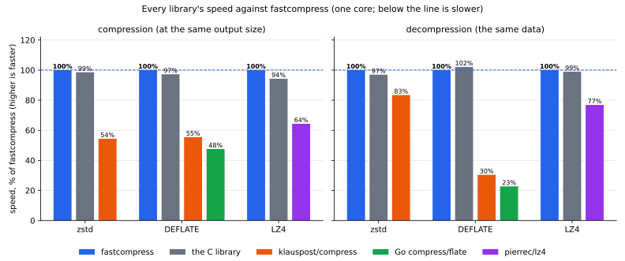
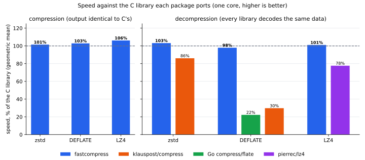
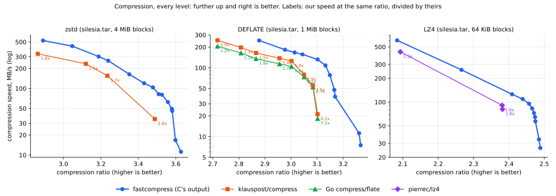
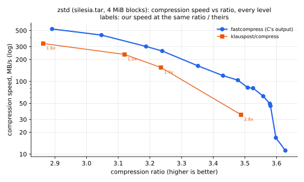
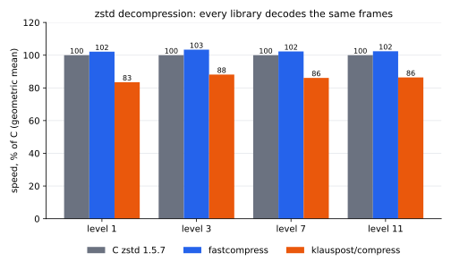
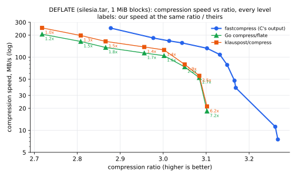
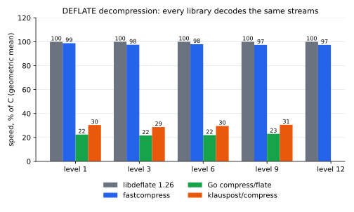
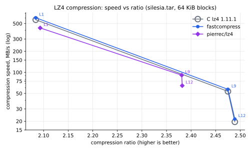
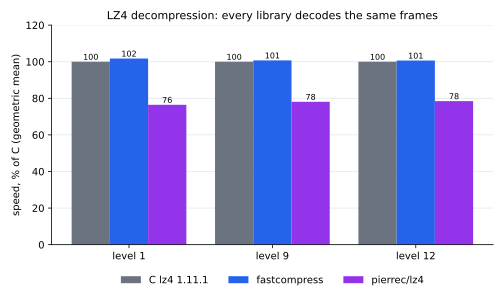

# Benchmarks

Speed of fastcompress against the C library each package ports and the
other Go libraries for the same format. Single-threaded, one core, the
[Silesia corpus](https://sun.aei.polsl.pl/~sdeor/index.php?page=silesia).
The [README](README.md) has the summary.

## Overview

All bars are a percentage of fastcompress's speed: compression at the same
output size (C's output is ours; the other Go libraries at the same
compression ratio, from every level), decompression on the same data.

- **Same speed as C, or faster, with C's exact output.** Over every
  benchmark row, our zstd compresses at **101.5%** and decompresses at
  **103.2%** of C zstd's speed; DEFLATE at **102.8%** and **97.9%** of
  libdeflate's; LZ4 at **106%** and **101%** of C lz4's.
- **Decompression against the other Go libraries** (every library decodes
  the same C-made data, so the bars compare like with like): we decode
  DEFLATE about **4.4x as fast as Go's `compress/flate`** and **3.3x as fast
  as klauspost**, zstd **1.2x as fast as klauspost**, and LZ4 **1.3x as fast
  as pierrec/lz4**.
- **Compression against the other Go libraries: faster at the same output
  size, at every level.** Their level N is not C's level N (most do less
  work and write larger output), so the chart below compares speed at the
  same compression ratio, across every level of every library. At the same
  ratio we compress **1.5x to 2.8x as fast as klauspost** (zstd), **1.0x to
  6.2x as fast as klauspost** and **1.2x to 7.2x as fast as Go's
  `compress/flate`** (DEFLATE), and **1.3x to 1.8x as fast as pierrec/lz4**
  (LZ4). The one 1.0x point is klauspost's DEFLATE level 2, whose output is
  6% larger than our fastest level's.

Single-threaded, one core, Silesia corpus. The bar chart and the tables
are the median of three interleaved runs, as geometric means over every
file, block size and level; the speed-against-ratio chart is one input per
codec at every level, the faster of two runs (`bench/sweep.sh`). Treat
differences of a few percent as noise. The per-codec sections below have
every row; the charts come from `bench/plot.py`.

<table>
<tr><th></th><th>compression: speed against ratio</th><th>decompression: % of C</th></tr>
<tr><td><b>zstd</b></td>
<td></td>
<td></td></tr>
<tr><td><b>DEFLATE</b></td>
<td></td>
<td></td></tr>
<tr><td><b>LZ4</b></td>
<td></td>
<td></td></tr>
</table>

In the compression charts, **up and to the right is better** (faster and
smaller). Levels are each library's own, so speed alone would not be a fair
comparison.

## By level

### zstd by level

Against C zstd v1.5.7 and klauspost/compress/zstd v1.20.3 (16
Silesia rows per level; [details](#zstd)):

| level | compression: ours / klauspost | ratio: C and ours / klauspost | decompression: ours / klauspost |
|---|---|---|---|
| 1 | 100.3% / 71.7% | 2.877 / 2.844 | 102.1% / 82.7% |
| 3 | 97.8% / 74.5% | 3.146 / 3.087 | 103.8% / 87.6% |
| 7 | 102.4% / 160.4% | 3.453 / 3.236 | 103.8% / 87.4% |
| 11 | 105.6% / 73.8% | 3.591 / 3.483 | 103.0% / 86.7% |
| **all** | **101.5%** / 89.2% | 3.255 / 3.154 | **103.2%** / 86.1% |

### DEFLATE by level

Against libdeflate v1.26, Go's `compress/flate` and
klauspost/compress/flate v1.20.3 (15 Silesia rows per level; the Go
libraries have no levels 10 to 12; [details](#deflate-gzip-and-zlib)):

| level | compression: ours / `compress/flate` / klauspost | ratio: libdeflate and ours / the other two | decompression: ours / `compress/flate` / klauspost |
|---|---|---|---|
| 1 | 101.6% / 88.4% / 105.5% | 2.810 / 2.592 | 98.8% / 22.4% / 30.3% |
| 3 | 99.1% / 106.9% / 127.3% | 2.950 / 2.755 | 97.6% / 21.7% / 28.6% |
| 6 | 98.7% / 105.8% / 125.7% | 3.097 / 2.973 | 97.9% / 21.9% / 29.6% |
| 9 | 97.9% / 54.7% / 62.4% | 3.147 / 3.095 | 97.4% / 23.0% / 30.5% |
| 12 | 118.2% / - / - | 3.253 / - | 97.4% / - / - |

### LZ4 by level

Against C lz4 v1.11.1 and pierrec/lz4/v4 v4.1.33 (frames of 4 MiB
blocks; xml, dickens and ooffice; pierrec's levels mapped as described in
[its comparison](#compared-with-pierreclz4)):

| level | compression: ours / pierrec | ratio: C and ours / pierrec | decompression: ours / pierrec |
|---|---|---|---|
| 1 | 104.3% / 58.1% | 2.172 / 2.312 | 102.0% / 76.1% |
| 9 | 106.5% / 111.3% | 3.022 / 2.866 | 100.6% / 78.9% |
| 12 | 105.8% / 175.8% | 3.050 / 2.867 | 100.5% / 79.5% |

## zstd

Single-threaded speed against C `zstd` v1.5.7 (`zstd -b -T1`) and
[klauspost/compress/zstd](https://github.com/klauspost/compress) v1.20.3,
over the Silesia corpus: the 12 files whole, plus `silesia.tar` in
independent 16 KiB, 128 KiB, 1 MiB and 4 MiB blocks (16 rows per level).
Checksums are off, and each cell is the median of three interleaved runs
of `bench/compare.sh -k`. Treat differences of a few percent as noise.

**Compression.** **Our output is byte-identical to C's**, so speed is the only
difference between the two. klauspost produces different output: its named
levels are its own and do not match C's, so the chart plots speed against
compression ratio instead of speed alone. A point further up and to the
right is better.

| level | ours, % of C's speed (geomean) | ours, lowest row | klauspost, % of C's speed | ratio, C and ours | ratio, klauspost |
|---|---|---|---|---|---|
| 1 | 100.3% | 97.2% (x-ray) | 71.7% | 2.877 | 2.844 |
| 3 | 97.8% | 81.2% (xml)* | 74.5% | 3.146 | 3.087 |
| 7 | 102.4% | 98.1% (`silesia.tar`, 16 KiB blocks) | 160.4% | 3.453 | 3.236 |
| 11 | 105.6% | 95.2% (reymont) | 73.8% | 3.591 | 3.483 |
| **all** | **101.5%** | | 89.2% | 3.255 | 3.154 |

Ratios are geometric means over the 16 rows of each level. klauspost's
`SpeedBetterCompression` (level 7) is faster than C's level 7 because it
compresses less (6.3% below C's ratio); its other levels are 25-28% slower
than C and compress 1-3% less.

\* The xml row at level 3 swings between runs on a shared machine (81% in
this run, 87% and 98.5% in earlier ones); on a quiet core it measures
about 101% of C. Without it, level 3's lowest row is 94.2% (`silesia.tar`,
4 MiB blocks).

**Decompression.** Every library decodes the same frames (ours, which are
C's), so the bars compare like with like. Geometric mean of the
percentage of C's speed:

| level | ours | klauspost |
|---|---|---|
| 1 | 102.1% | 82.7% |
| 3 | 103.8% | 87.6% |
| 7 | 103.8% | 87.4% |
| 11 | 103.0% | 86.7% |
| **all** | **103.2%** | 86.1% |

Our lowest decompression row is `silesia.tar` in 16 KiB blocks at level 1
(95.8%). klauspost falls to about 66% of C on the 128 KiB and 16 KiB rows.

**Higher levels (13 to 22).** Ported from C as well (btultra, btultra2, the
post-block splitter and long-distance matching), reached with
`WithEncoderZstdLevel`; the output is C's. Speed as a percentage of C's, on
four inputs (xml, dickens, ooffice and `silesia.tar` in 1 MiB blocks):

| level | compression | decompression |
|---|---|---|
| 13 | 95-100% | 100-105% |
| 16 | 103-112% | 101-104% |
| 19 | 87-114% | 101-105% |
| 22 | 97-132% | 102-105% |

Expect other CPUs to give different numbers. The decompression chart is
drawn from the `bench/compare.sh` output by `bench/plot.py`. The compression chart has every level of each library
(`bench/sweep.sh`, `bench/plot.py frontier`); its labels give our speed at
the same ratio divided by theirs.

**arm64.** On an arm64 server core (the same method on dickens, mozilla,
ooffice, xml and x-ray whole, C built from source with gcc -O2), compression
is 88.7% of C's speed at level 1, 88.9% at 3, 89.1% at 7, 92.3% at 11 and
87.4% at 19 (geomean; rows 81-99%), decompression 99.9%, 98.3%, 93.3%,
92.0% and 92.9%. Most of the remaining gap at levels 1 to 7 is in the match
finders and the sequence encoder, which are in arm64 assembly already; the
optimal parser is Go there (amd64 has it in assembly for levels 16 and 17),
with the binary-tree match finder in assembly. C's own speed varied by up to
about 8% between runs on that machine.

## DEFLATE, gzip and zlib

Single-threaded speed of raw DEFLATE against libdeflate v1.26 (built as it
ships, with its BMI2 decoder and SIMD paths on), Go's `compress/flate` and
[klauspost/compress/flate](https://github.com/klauspost/compress) v1.20.3,
over the Silesia corpus: the 12 files whole, plus `silesia.tar` in
independent 16 KiB, 128 KiB and 1 MiB blocks (15 rows per level). Each cell
is the median of three interleaved runs of `bench/gzip/compare.sh`; amd64
assembly on. Treat differences of a few percent as noise. The Go standard
library and klauspost have no levels 10 to 12.

**Compression.** **Our output is byte-identical to libdeflate's at every
level** (all 75 rows), so speed is the only difference between the two. The
Go standard library and klauspost produce other output (2-9% larger than
libdeflate's at the same level number), so the chart plots speed against
compression ratio. A point further up and to the right is better.

| level | ours, % of libdeflate's speed (geomean) | ours, lowest row | Go `compress/flate`, % of libdeflate | klauspost, % of libdeflate | ratio, libdeflate and ours | ratio, `compress/flate` and klauspost |
|---|---|---|---|---|---|---|
| 1 | 101.6% | 99.5% (ooffice) | 88.4% | 105.5% | 2.810 | 2.592 |
| 3 | 99.1% | 96.5% (nci) | 106.9% | 127.3% | 2.950 | 2.755 |
| 6 | 98.7% | 74.1% (nci; the other 14 rows are 96-101%) | 105.8% | 125.7% | 3.097 | 2.973 |
| 9 | 97.9% | 86.4% (`silesia.tar`, 128 KiB blocks) | 54.7% | 62.4% | 3.147 | 3.095 |
| 12 | 118.2% | 104.3% (sao) | - | - | 3.253 | - |

Ratios are geometric means over the 15 rows of each level. Go 1.27's
`compress/flate` and klauspost produce the same compressed size on 59 of
the 60 rows (on the other, level 9 on `silesia.tar` in 128 KiB blocks,
the ratios are 3.046 and 3.045), so they share a ratio column; klauspost is the faster of the two. At levels 3 and 6 both
are faster than libdeflate and compress 4-7% less.

**Decompression.** Every library decodes the same libdeflate streams, so
the bars compare like with like. Geometric mean of the percentage of
libdeflate's speed:

| level | ours | Go `compress/flate` | klauspost |
|---|---|---|---|
| 1 | 98.8% | 22.4% | 30.3% |
| 3 | 97.6% | 21.7% | 28.6% |
| 6 | 97.9% | 21.9% | 29.6% |
| 9 | 97.4% | 23.0% | 30.5% |
| 12 | 97.4% | - | - |

Our lowest decompression row is samba at level 3 (91.6%). **We decompress
about 4.4 times as fast as the Go standard library and 3.3 times as fast as
klauspost.**

The decoder's margin against libdeflate depends on the CPU and on code
layout: the fast loop's alignment is tuned, and on another CPU the same
code measured 100.2-100.6% of libdeflate. The pure-Go build (`-tags noasm`)
is slower and is not measured here. The decompression chart is drawn from
the `bench/gzip/compare.sh` output by `bench/plot.py`. The compression chart has every level of each library
(`bench/sweep.sh`, `bench/plot.py frontier`); its labels give our speed at
the same ratio divided by theirs.

**arm64.** On an arm64 server core (the same method on dickens, mozilla,
ooffice, xml and x-ray whole; libdeflate built from source with gcc -O2),
compression is 97.0% of libdeflate's speed at level 1, 97.5% at 6, 100.9%
at 9 and 113.0% at 12 (geomean; the lowest row is level 1 on x-ray,
93.5%), and decompression 97.4-98.8% by level (rows 95.6-102.2%). The
pure-Go code ran at 57-76% of libdeflate for compression and 52-56% for
decompression on the same core.

## LZ4

Single-threaded frame speed against C `lz4` v1.11.1 (`lz4 -b<L> -T1 -B4M`:
one frame per file, 4 MiB independent blocks, no checksums) on three Silesia
files, and on `silesia.tar` in 64 KiB blocks (`-B64K`), measured with
`bench/compare-lz4.sh` (median of three interleaved runs, each the best
mean of ~1 s windows over 3 s, pinned to one core). **The output is
byte-identical** (equal ratios on every row). **Every level from 1 to 12
compresses at 101 to 116% of C's speed, and decoding runs at 101 to
104%.** Treat a few percent as noise
(the closest rows, level 1 on xml and the decoder on dickens, are within
it); other CPUs give other numbers.

| level | xml | dickens | ooffice | geomean | silesia.tar, 64 KiB |
|---|---|---|---|---|---|
| 1 (fast) compression | 101.0% | 102.4% | 106.0% | 103.1% | 106.8% |
| 2 (LZ4MID) compression | 101.8% | 102.2% | 103.8% | 102.6% | 103.1% |
| 3 (hash chain) compression | 107.7% | 111.3% | 109.9% | 109.6% | 111.5% |
| 4 compression | 109.3% | 115.5% | 112.2% | 112.3% | 112.7% |
| 5 compression | 108.9% | 115.9% | 112.2% | 112.3% | 112.5% |
| 6 compression | 107.9% | 112.7% | 111.5% | 110.7% | 111.2% |
| 7 compression | 105.9% | 110.4% | 110.5% | 108.9% | 110.0% |
| 8 compression | 104.8% | 108.6% | 109.9% | 107.7% | 108.8% |
| 9 (hash chain) compression | 104.2% | 107.5% | 107.7% | 106.5% | 107.7% |
| 10 (optimal) compression | 104.7% | 104.0% | 108.1% | 105.6% | 108.5% |
| 11 compression | 104.6% | 103.6% | 108.6% | 105.6% | 108.6% |
| 12 (optimal) compression | 106.2% | 104.2% | 109.7% | 106.7% | 110.2% |
| 1 decompression | 104.4% | 101.9% | 103.4% | 103.2% | 102.4% |
| 9 decompression | 102.3% | 101.4% | 103.0% | 102.2% | 101.7% |
| 12 decompression | 102.5% | 101.1% | 102.0% | 101.9% | 102.1% |

The HC levels gain most from running the whole parser in one routine: C
inlines `LZ4HC_InsertAndGetWiderMatch` into each parser, and so does the
assembly. C's `-T1` runs its job mode with one worker thread, which costs C
about 2% against `--single-thread`. The pure-Go build (`-tags noasm`) is
slower (measured before the assembly: 40 to 55% of C at level 1, 15 to 25%
for decoding).

**arm64.** On an arm64 server core (the same method with 4 MiB blocks on
dickens, mozilla, ooffice, xml and x-ray, C built from source with gcc -O2),
compression is 102.0% of C's speed at level 1, 100.8% at 2, 104.8% at 9 and
103.6% at 12 (geomean; the lowest row is level 2 on dickens, 92.7%), and
decompression 97.9% (level 1) and 98.3% (level 9); the pure-Go code ran at
37-59% of C for compression and 28-30% for decompression on the same core.

The other frame modes, against C with `--single-thread` (the same method;
xml, dickens and ooffice; equal ratios on every row): linked blocks
(`-BD`), a dictionary (`-D`: 64 KiB from the middle of the file, digested
once into a CDict; with 4 MiB blocks C copies the dictionary state into the
stream at every level but 2, which searches the attached dictionary for
the whole block), and `--favor-decSpeed`. The lowest rows, level 1 with a
dictionary on xml in 4 MiB blocks (98.5%, four runs between 97.8 and
98.7%) and `favorDecSpeed` at level 10 on xml (98.9 to 99.3%), are below C
by about 1%; cells within 2% of 100% are noise-level.

| mode, level | 4 MiB: xml | dickens | ooffice | 64 KiB: xml | dickens | ooffice |
|---|---|---|---|---|---|---|
| linked, 1 | 101.5% | 101.7% | 102.0% | 101.2% | 102.2% | 100.6% |
| linked, 2 | 100.4% | 100.6% | 103.3% | 100.1% | 100.3% | 102.8% |
| linked, 4 | 107.2% | 112.1% | 108.9% | 106.8% | 107.5% | 109.2% |
| linked, 9 | 103.8% | 106.7% | 107.4% | 103.9% | 106.4% | 106.3% |
| linked, 12 | 104.4% | 103.0% | 107.7% | 104.1% | 103.0% | 108.2% |
| dictionary, 1 | 98.5% | 100.2% | 101.5% | 104.5% | 100.3% | 103.1% |
| dictionary, 2 | 101.0% | 100.9% | 106.0% | 103.2% | 102.4% | 105.3% |
| dictionary, 4 | 104.8% | 112.1% | 109.2% | 103.9% | 110.6% | 108.5% |
| dictionary, 9 | 103.5% | 106.6% | 105.4% | 103.7% | 105.8% | 104.4% |
| dictionary, 12 | 103.8% | 103.1% | 107.3% | 103.8% | 100.7% | 105.7% |
| favorDecSpeed, 10 | 99.3% | 100.6% | 103.8% | 98.9% | 100.4% | 103.9% |
| favorDecSpeed, 11 | 100.3% | 100.0% | 104.3% | 99.5% | 100.0% | 104.3% |
| favorDecSpeed, 12 | 102.3% | 100.0% | 104.4% | 102.1% | 100.0% | 105.2% |
| linked, 1 decompression | 103.6% | 101.1% | 103.2% | 101.4% | 100.5% | 98.8% |
| linked, 9 decompression | 103.4% | 101.8% | 104.0% | 100.8% | 101.0% | 101.0% |

Before this assembly the same rows measured 58 to 64% (level 2 with a
dictionary), 57 to 87% (HC levels with a dictionary), 62 to 81%
(`favorDecSpeed`) and 70 to 98% (HC levels, linked 64 KiB blocks).

Multi-threaded frames (`NbWorkers`, against C's `lz4 -T<n>`, which reads
its stable input in place as `UpdateStable` does) on `silesia.tar`, 64 KiB
blocks, both pinned to the same 8 cores (one thread each, no SMT
siblings), median of three interleaved runs (MB/s, Go then C, and Go's %
of C); the ratios are equal, linked frames included (C's job output):

| threads | independent, level 1 | independent, level 9 | linked, level 1 | linked, level 9 |
|---|---|---|---|---|
| 1 | 398 / 383 (103.8%) | 21.5 / 19.4 (110.8%) | 379 / 366 (103.7%) | 21.0 / 19.2 (109.4%) |
| 2 | 807 / 680 (118.7%) | 41.7 / 38.4 (108.6%) | 749 / 723 (103.6%) | 42.2 / 37.7 (111.9%) |
| 4 | 1534 / 1483 (103.4%) | 79.0 / 74.8 (105.6%) | 1492 / 1413 (105.6%) | 80.9 / 75.1 (107.7%) |
| 8 | 2543 / 2576 (98.7%) | 147 / 145 (101.2%) | 2485 / 2409 (103.1%) | 147 / 145 (101.0%) |

Level 9 scales 6.8 times from 1 to 8 threads (C 7.5 times, from a slower
start); level 1 at 8 threads (2.5 GB/s) is within noise of C. The 2-thread
independent row's C value was low in each of its runs.

### Compared with pierrec/lz4

[pierrec/lz4/v4](https://github.com/pierrec/lz4) v4.1.33 is timed by
`bench/compare-lz4.sh -p` (`bench/lz4`, a nested module) with the same
method, interleaved with C and ours: one reused `lz4.Writer` per pass
(independent blocks, no checksums, `ConcurrencyOption(1)`, 4 MiB writes),
and for decompression one reused `lz4.Reader` decoding our frames, which
are C's, so all three decoders see the same input. pierrec's levels are its
own: level 1 runs its default `Fast` compressor, level 9 `CompressorHC`
`Level1` (up to 512 candidates per position, the nearest to C's 256 at
level 9) and level 12 `Level9` (its highest; pierrec has no optimal
parser). Its output differs from C's, so its ratio is shown. A separate
run from the table above (median of three interleaved runs, 3 s each).

| file, level | compression: ours / pierrec (% of C) | ratio: C and ours / pierrec | decompression: ours / pierrec (% of C) |
|---|---|---|---|
| xml, 1 | 102.0% / 72.0% | 4.542 / 4.715 | 102.9% / 76.1% |
| xml, 9 | 104.4% / 98.5% | 6.928 / 6.435 | 101.4% / 72.8% |
| xml, 12 | 105.3% / 179.4% | 7.021 / 6.442 | 101.4% / 74.1% |
| dickens, 1 | 103.8% / 58.7% | 1.591 / 1.824 | 100.4% / 79.1% |
| dickens, 9 | 107.4% / 104.1% | 2.295 / 2.186 | 98.6% / 82.5% |
| dickens, 12 | 103.6% / 147.9% | 2.324 / 2.187 | 99.3% / 82.9% |
| ooffice, 1 | 107.1% / 46.4% | 1.418 / 1.437 | 102.6% / 73.2% |
| ooffice, 9 | 107.8% / 134.4% | 1.735 / 1.673 | 101.7% / 81.8% |
| ooffice, 12 | 108.7% / 204.6% | 1.739 / 1.673 | 100.9% / 81.8% |
| `silesia.tar` 64 KiB, 1 | 106.8% / 76.4% | 2.084 / 2.093 | 101.2% / 77.5% |
| `silesia.tar` 64 KiB, 9 | 106.9% / 170.5% | 2.475 / 2.381 | 101.2% / 75.7% |
| `silesia.tar` 64 KiB, 12 | 109.7% / 329.6% | 2.489 / 2.382 | 100.9% / 75.4% |

pierrec's `Fast` compresses more than C's level 1 (6.4% higher ratio,
geomean of the 4 MiB rows) at 58% of its speed. Its HC levels compress
5-6% less than C's levels 9 and 12, and are faster than those two levels
on most rows (geomean 111.3% and 175.8% of C), but **at the same ratio our
lower levels are faster: 1.6x and 1.8x as fast as pierrec's HC, and 1.3x
as fast as its `Fast`** (the chart above, every level of both libraries on
`silesia.tar` in 64 KiB blocks). `Level1` and `Level9` give almost the
same ratio. It decodes at 73-83% of C's speed.

