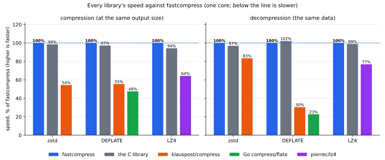

# fastcompress

Pure-Go ports of three C compression libraries, with output byte-identical
to C and speed at or near C's:

| package | port of | API |
|---|---|---|
| `zstd` | [zstd](https://github.com/facebook/zstd) v1.5.7, levels 1 to 22 | the API of [klauspost/compress/zstd](https://github.com/klauspost/compress) |
| `flate`, `gzip`, `zlib` | [libdeflate](https://github.com/ebiggers/libdeflate) v1.26, levels 0 to 12 | the standard library's `compress/*` streams, plus libdeflate's whole-buffer API |
| `lz4` | [lz4](https://github.com/lz4/lz4) v1.11.1, levels 1 to 12 | C's block, HC and frame API, plus `io.Writer`/`io.Reader` |

No cgo and no dependencies. Hot loops have amd64 and arm64 assembly; every
other platform (and the `noasm` build tag) runs the same algorithms in Go.
The decoders are written for untrusted input (see [Safety](#safety)).

```
go get github.com/vahid-sohrabloo/fastcompress
```

## Speed



- **Faster than every other Go library**, for compression and
  decompression, in all three formats: at the same output size, klauspost
  needs about **1.8x our time** to compress zstd or DEFLATE, Go's
  `compress/flate` about **2.1x**, and pierrec/lz4 about **1.6x**; to
  decompress, Go's `compress/flate` needs **4.4x** our time, klauspost
  **3.3x** (DEFLATE) and **1.2x** (zstd), pierrec/lz4 **1.3x**.
- **As fast as C**, with C's exact output: within a few percent of the C
  library either way (the grey bars).

Single-threaded, one core, Silesia corpus. Every number, chart and method
is in **[BENCHMARKS.md](BENCHMARKS.md)**.

## Quick start

```go
import (
	"bytes"

	"github.com/vahid-sohrabloo/fastcompress/gzip"
	"github.com/vahid-sohrabloo/fastcompress/lz4"
	"github.com/vahid-sohrabloo/fastcompress/zstd"
)

// zstd: the klauspost/compress/zstd API; output is C zstd's at the same level.
enc, _ := zstd.NewWriter(nil, zstd.WithEncoderLevel(zstd.SpeedDefault))
compressed := enc.EncodeAll(data, nil)
dec, _ := zstd.NewReader(nil)
plain, err := dec.DecodeAll(compressed, nil)

// gzip: a drop-in for compress/gzip ...
var buf bytes.Buffer
w := gzip.NewWriter(&buf)
w.Write(data)
w.Close()
// ... or libdeflate's whole-buffer API (levels 0 to 12).
c, _ := gzip.NewCompressor(9)
gz, err := c.AppendCompress(nil, data)
out, err := gzip.NewDecompressor().AppendDecompress(nil, gz, len(data))

// lz4: frames through io.Writer / io.Reader, or C's block functions.
zw := lz4.NewWriter(&buf, lz4.WithLevel(9))
zw.Write(data)
zw.Close()
zr := lz4.NewReader(&buf)
```

Each package's documentation has the full API; the sections below cover how
it maps to C, what differs, the tests and the speed.

**Byte-identical to C** means: for the same input and parameters, the
compressed bytes equal the C library's, checked by differential tests
against the C code over the Silesia corpus and fuzzing. The decoders accept
and reject what C accepts and rejects, with C's error class. The few
deliberate differences are listed per package
([zstd](#deliberate-api-differences), [DEFLATE](#deflate-gzip-and-zlib),
[LZ4](#lz4)).

## Encoder output

Each `EncoderLevel` runs C's compression level: `SpeedFastest` 1,
`SpeedDefault` 3, `SpeedBetterCompression` 7, `SpeedBestCompression` 11.
The output is byte-identical to C zstd v1.5.7 with the same parameters,
except that `WithEncoderDictRaw` writes its dictionary ID into the frame
header (C writes none for raw content); everything after that field is C's.

## Decoder

`NewReader` and `Decoder` (`DecodeAll`, the streaming `io.Reader`,
`WriteTo`), dictionaries, `ZipDecompressor` and `SnappyConverter` are
ported from C's `zstd_decompress*.c` and `huf_decompress.c`. Output and
error class are checked against C v1.5.7 by differential tests over a
corpus of C-made frames, and fuzz targets compare the paths against each
other (`DecodeAll`, streaming at any input cut, concurrent streaming, and
any `dst` capacity). C errors map to the klauspost sentinels.

### Safety

The decoder is written for untrusted input: corrupt, truncated or hostile
data returns an error, never a panic or an out-of-bounds access, and memory
is bounded by `WithDecoderMaxMemory`. CI enforces this:

- `scripts/decodercheck.sh`: no decoder file imports `unsafe` or calls
  `recover` (one exception: the streaming pipeline re-raises a panic of the
  caller's `io.Reader` on the caller's goroutine). Decoder assembly needs a
  `// BOUNDS:` proof per routine and a fuzz target comparing it with the Go
  code.
- `scripts/fuzz.sh`: every fuzz target runs for 20 s per push (amd64),
  and for 10 minutes nightly on amd64 and arm64, with the assembly on, off
  and (amd64) without BMI2. Every target's seed corpus also runs as a test,
  with and without the `noasm` tag.
- A coverage gate: `zstd_decompress*.go` and `huf_decompress.go` must each
  stay at 95% statement coverage or more.

## Deliberate API differences

- `WithHugePages` is an extension (not a klauspost option): it backs the
  large match tables with transparent huge pages on Linux. Speed only; off by
  default.
- `WithSingleSegment` is accepted and ignored: the frame header follows C's
  automatic choice, so output stays identical to C.
- `WithConcurrentBlocks` and `WithLowerEncoderMem` are accepted and have no
  effect. Encoding is single-threaded per call (C's `nbWorkers = 0`).
  `WithEncoderConcurrency(n)` caps the number of concurrent `EncodeAll` calls;
  streams are never async.
- `BuildDict` returns C's `ZDICT_finalizeDictionary` output. Non-zero
  `Offsets` replace C's starting repcodes {1, 4, 8} (the history is
  zero-padded in front up to the largest); `CompatV155` changes nothing, as
  C's dictionaries already load in zstd v1.5.5.
- `TrainDict`, `TrainDictCover`, `TrainDictFastCover` and `CoverParams`
  are extensions: C's dictionary trainers (`ZDICT_trainFromBuffer`, COVER
  and fastCover), byte-identical to C v1.5.7, parameters included.
- `WithEncoderZstdLevel(n)` is an extension: it runs C compression level
  `n` (1 to 22) directly instead of one of the four `EncoderLevel`s, with
  C's output at that level, including C's long-distance matching, which C
  turns on by itself for levels 16 to 22 with a window of 128 MiB or more
  (level 22 above 64 MiB or for an unknown size, or levels 16 to 21 with a
  `WithWindowSize` of 128 MiB or more).
- `EncoderLevelFromZstd` maps a zstd level to the highest `EncoderLevel`
  whose C level (1, 3, 7, 11) does not exceed it.

## DEFLATE, gzip and zlib

Packages `flate`, `gzip` and `zlib` are a Go port of
[libdeflate](https://github.com/ebiggers/libdeflate) v1.26 (no cgo; amd64
assembly for the hot loops, see below). Each package has two APIs:

- **Streaming, a drop-in for the standard library's `compress/flate`,
  `compress/gzip` and `compress/zlib`**: `NewWriter`, `NewWriterLevel`
  (gzip, zlib), `NewWriterDict` / `NewWriterLevelDict`, `Flush`, `Reset`,
  `HuffmanOnly`, gzip `Header` fields; `NewReader`, `NewReaderDict`,
  `Resetter`, `Multistream`, and the standard library's error types.
  `scripts/apicheck.sh` compares the exported API with the standard
  library's; the extra identifiers are listed in `api/stdlib-*-delta.txt`.
  C has no streaming API, so both sides are new design around the port:
  the `Writer` compresses 1 MiB chunks with 32 KiB of history, and its
  output is byte-identical to libdeflate only when at most 1 MiB is
  written and `Flush` is never called; the `Reader` runs libdeflate's
  decoder and suspends at symbol boundaries. Details in the `flate`
  package documentation.
- **Whole-buffer, libdeflate's own API**, described below.

The whole-buffer API:

- `NewCompressor(level)` with levels -1..12: `NoCompression` (0),
  `BestSpeed` (1) .. `BestCompression` (9), `DefaultCompression` (-1 =
  level 6), and the extensions `Level10`..`Level12` (libdeflate's
  near-optimal parsing). `Compress(dst, src)` into a caller buffer
  (`ErrShortBuffer` if too small; `CompressBound` is always enough) and
  `AppendCompress`. The output is byte-identical to libdeflate's at the
  same level (gzip: one member, no name, MTIME 0, OS 255; zlib: no
  dictionary).
- `NewDecompressor()`: `Decompress(dst, src)` needs the exact
  decompressed size (libdeflate semantics: `ErrShortOutput` /
  `ErrInsufficientSpace` otherwise); `DecompressEx` accepts a larger
  buffer and reports the input and output sizes; `AppendDecompress`
  handles unknown sizes, bounded by `SetMaxOutput` (1 GiB by default)
  against decompression bombs. gzip decodes the first member only; zlib
  rejects preset dictionaries. Inputs are accepted and rejected exactly as
  libdeflate does (differential tests against the C library).
- No allocation per call with reused instances, except when an
  `AppendCompress` / `AppendDecompress` dst lacks the capacity (pool them:
  a level 6 compressor holds about 660 KiB, levels 10..12 about 8.6 MiB,
  a decompressor 13 KiB); instances are not safe for concurrent use. A
  zero `Compressor` is not usable (use `NewCompressor`); a zero
  `Decompressor` is.
- dst must not overlap src (for the `Append` forms: the whole capacity of
  dst); in-place use silently gives bad output or `ErrBadData`.
  `AppendDecompress` allocates its `sizeHint` up front, so do not pass an
  untrusted hint (e.g. a gzip ISIZE) without lowering `SetMaxOutput`.
- The error values are shared by the three packages
  (`gzip.ErrBadData == flate.ErrBadData`).

`HuffmanOnly` (-2) is accepted by the streaming `Writer` only; it has no
libdeflate counterpart, so its output is not compared with libdeflate's.

### Assembly

On amd64 (unless built with `-tags noasm` or `purego`) assembly replaces
the Go code of the decoder's fast loop (only on CPUs with BMI2, as
libdeflate's own BMI2 decoder; other CPUs run the Go loop), the level 1
loop, the greedy / lazy / lazy2 loops of levels 2..9 with the hash-chain
match finder, the sequence writer of the block flush, the match finder's
table init / rebase (SSE2), and, for the near-optimal levels 10..12, the
binary-tree match finding loop (`btMatchLoopAsm`) and the backward
min-cost-path pass (`minCostPathAsm`). The rest of levels 10..12 and
Adler-32 are Go only; CRC-32 is `hash/crc32`. Each routine has a fuzz
target comparing it with the Go code. On arm64 assembly runs the decoder's
fast loop, the level 1 loop, the lazy / lazy2 loop of levels 5..9 and the
hash-chain search (`hcLongestMatchAsm`, which the Go greedy loop of levels
2..4 calls), the match finder's table init / rebase (NEON), and the
binary-tree match finding loop and the min-cost-path pass of levels 10..12;
the block flush and the greedy loop itself are Go there. Every other
architecture runs pure Go.

### Speed

See [BENCHMARKS.md](BENCHMARKS.md#deflate-gzip-and-zlib).

### Tests

The tests compare against libdeflate v1.26 run as a C subprocess
(`ref/fetch.sh`, then `make -C ref/ldref`). The full suite is heavy (whole
Silesia files and `silesia.tar` blocks at every level, against C), so run
it through `scripts/deflate-test.sh`, which serialises runs with `flock`
and caps each one with `systemd-run` (6G `MemoryMax`, no swap,
`GOMEMLIMIT` 4GiB by default):

    scripts/deflate-groups.sh -v -run FILE...      # quick tier: the tests of the changed files
    scripts/deflate-test.sh -t quick               # whole internal/deflate package, -short
    scripts/deflate-test.sh -t full -a on,off,nobmi2 lazy nopt rest equiv dec other
    scripts/deflate-test.sh -t full noasm flate gzip zlib creftest

On one 20-thread laptop a full-tier pass of internal/deflate takes about
21 to 25 minutes per assembly mode. CI splits internal/deflate into those six
partitions (`scripts/deflate-groups.sh -regex`), each a matrix job on amd64
and arm64 (default build, then `-tags noasm`), plus jobs for the other
packages and for 386 / race `-short`. Details:
[scripts/README-deflate-tests.md](scripts/README-deflate-tests.md).

## LZ4

Package `lz4` is a port of [lz4](https://github.com/lz4/lz4) v1.11.1
(`lz4.c`, `lz4hc.c`, `lz4frame.c`): the block format, the fast compressor,
the high compression levels 2 to 12 and the frame format. Every compressor
produces C's bytes for the same calls in the same order; the decoders accept
and reject what C accepts and rejects, with C's error class.

**Blocks** (C's API, with `dst` as a buffer whose length is the capacity):

- `CompressFast(dst, src, acceleration)` / `CompressDefault` /
  `CompressDestSize` (`LZ4_compress_fast`, `_default`, `_destSize`), and
  `CompressHC(dst, src, level)` / `CompressHCDestSize` (`LZ4_compress_HC`,
  levels 2 to 12: LZ4MID at 2, hash chains at 3 to 9, the optimal parser at
  10 to 12). `CompressBound(n)` bytes are always enough; otherwise 0 means
  the block did not fit.
- `Stream` (`LZ4_stream_t`) and `StreamHC` (`LZ4_streamHC_t`): independent
  blocks that reuse the tables (`CompressFast`, `Compress`), streaming with
  `CompressFastContinue` / `CompressContinue` (prefix and external
  dictionary modes), `LoadDict`, `LoadDictSlow`, `AttachDictionary`,
  `SaveDict`, `FavorDecompressionSpeed`.
- `DecompressSafe`, `DecompressSafePartial` and the `UsingDict` variants
  return `ErrCorrupt`, `ErrDstTooSmall` or `ErrOffset` (C's -1, -2, -3).

C chooses between its prefix and external-dictionary modes by comparing
pointers. Here an input continues the history only when both are parts of
one slice (the history's capacity reaches the input); two separate
allocations that happen to be adjacent are compressed as an external
dictionary, where C would use the prefix. Both are valid; only the bytes
differ from C's in that case.

**Frames** (`lz4frame.c`):

- `CompressFrame` / `AppendFrame` / `CompressFrameUsingCDict`
  (`LZ4F_compressFrame`), `FrameCompressor` (`LZ4F_compressBegin`, `Update`,
  `Flush`, `End`) and `Writer` (an `io.WriteCloser`: each `Write` is one
  `LZ4F_compressUpdate`, so the frame is C's for the same sequence of writes
  and flushes). `Preferences` has C's fields: level, block size ID, linked or
  independent blocks, block and content checksums, content size, dictionary
  ID, `AutoFlush`, `FavorDecSpeed`, `NbWorkers`; `NewCDict`, `WithDict`,
  `WithCDict` for dictionaries, `WriteUncompressed` for uncompressed blocks,
  `UpdateStable` for input that stays until the next flush.
- Multi-threaded frames (C's `nbWorkers`, `lz4 -T#`): with
  `Preferences.NbWorkers` (or `WithConcurrency(n)` on a `Writer`) the
  content is cut into jobs at fixed positions (1 MB, or one block when
  larger, restarting at each flush), compressed by up to `NbWorkers`
  goroutines and emitted in order. The frame depends only on the content
  and the flush points, never on the number of workers or the scheduling:
  with independent blocks it is the single-threaded frame, with linked
  blocks it is C's multi-threaded frame (each job restarts with the
  previous 64 KB as dictionary). Output lags behind input: `Flush` and
  `Close`/`End` emit the jobs in flight; with `FrameCompressor`,
  `CompressBoundFrame` counts them (C emits them over several calls
  instead).
- `AppendDecompressFrame(dst, src, dict)` and `Reader` (`io.Reader`,
  `io.WriterTo`) decode concatenated frames and skip skippable frames, with
  C's header checks, checksums and error classes (`ErrFrameType`,
  `ErrHeaderChecksum`, `ErrBlockChecksum`, `ErrContentChecksum`,
  `ErrFrameSize`, `ErrDecompressionFailed`, `io.ErrUnexpectedEOF` for a
  truncated frame, ...).

Usage:

    dst := make([]byte, lz4.CompressBound(len(src)))
    n := lz4.CompressFast(dst, src, 1)
    out := make([]byte, len(src))
    m, err := lz4.DecompressSafe(out, dst[:n])

    w := lz4.NewWriter(f, lz4.WithLevel(9))
    io.Copy(w, r)
    w.Close()

    content, err := lz4.AppendDecompressFrame(nil, frame, nil)

Not ported: `LZ4_decompress_fast` (unsafe by design), the streaming block decoder
(`LZ4_decompress_safe_continue`; the frame decoders cover streams), the
legacy frame format of the `lz4` command, and the `lz4file.h` API.

### Safety

The decoder files (`lz4_decompress*.go`, `lz4frame_decompress*.go`) import
no `unsafe` and call no `recover` (`scripts/decodercheck.sh`); malformed
input returns an error, never a panic or an out-of-bounds access. The
decoder's assembly has a `// BOUNDS:` proof and a fuzz target comparing it
with the Go loop. `FuzzDecompress` and `FuzzDecompressFrame` compare every
result with C's decoders.

### Assembly

On amd64 (unless built with `-tags noasm` or `purego`) assembly runs the
decoder's fast loop (C's `LZ4_FAST_DEC_LOOP` part, without external
dictionary; linked frames decode with the history in the output, in
prefix mode), the fast compressor's main loop (one-shot with byU16 and
byU32 tables, the streaming prefix and external-dictionary modes with C's
resume-in-prefix split, the attached dictionary (`dictCtx`) of small
blocks, and `destSize`; limited or unlimited output), the LZ4MID main loop
of level 2, and the whole parsers of levels 3 to 12:
`LZ4HC_compress_hashChain` (levels 3 to 9) and
`LZ4HC_compress_optimal` (10 to 12), with the match search (table
insertion, candidate loop, pattern analysis, `chainSwap`) and the price
updates in the same routine. The LZ4MID loop and the parsers cover every
mode of C's: a prefix alone, an external dictionary (linked blocks, and
CDict frames, whose dictionary state C copies into the stream), an
attached dictionary (`dictCtx`: blocks below `dictCopyMin`, and LZ4MID
with any CDict), `favorDecSpeed`, and `destSize` (the assembly stops at
the sequence that does not fit, which Go encodes as C does). Each mode is
a separate routine assembled from one source (`#ifdef` variants), so the
prefix-only loops keep their instruction stream. Each falls back to Go
where C's code takes a path the assembly does not cover, and each has a
fuzz target comparing it with the Go code.
Baseline instructions only (SSE2; no BMI2 or AVX2 needed): 16-byte match
compares measured slower than 8-byte ones on the short matches that
dominate, except in LZ4MID's count past the first 8 bytes.
On arm64 assembly runs the decoder's fast loop, the fast compressor's
main loop (one-shot, the streaming prefix mode with its resume and
`destSize`; external and attached dictionaries run the Go loop), the LZ4MID
loop without dictionary, the candidate loop of the hash chain search, and
the whole hash chain and optimal parsers for a prefix without dictionary and
without `favorDecSpeed` (the other modes run the Go parsers with the
assembly candidate loop). The other architectures run the Go code.

### Speed

See [BENCHMARKS.md](BENCHMARKS.md#lz4).

### Tests

The tests compare against lz4 v1.11.1 run as a C subprocess
(`ref/fetch.sh`, then `make -C ref/lz4ref`): every encoder on the creftest
inputs and the Silesia corpus (the fast compressor at several accelerations
and with reused tables, every HC level 0 to 13 with and without
`favorDecSpeed`, streaming in prefix, external-dictionary and saved-history
layouts with loaded, slow-loaded and attached dictionaries, limited
capacities and `destSize`), frames for 64 preference sets and plans of
writes, flushes and uncompressed writes with raw and digested dictionaries,
multi-threaded frames (1, 3 and 8 workers, one-shot, `Writer` and
`UpdateStable`, against C's frames with `nbWorkers`), and the decoders on
valid, truncated and mutated blocks and frames. Fuzz targets compare the
assembly with the Go code in every compression mode (`FuzzHCDictAsmEquiv`,
`FuzzFastDictAsmEquiv` and the others), the multi-threaded frames across
worker counts (`FuzzFrameMT`), and the decoders and encoders with C's;
the concurrent paths run under the race detector. `go test -short ./lz4`
runs a subset; the full run takes about 40 minutes.

## Credits

- `zstd` is a port of [zstd](https://github.com/facebook/zstd) v1.5.7, by
  Yann Collet and the zstd contributors (Copyright Meta Platforms, Inc. and
  affiliates; BSD 3-Clause, see [LICENSE](LICENSE)).
- `flate`, `gzip` and `zlib` are a port of
  [libdeflate](https://github.com/ebiggers/libdeflate) v1.26, by Eric
  Biggers and the libdeflate contributors (MIT, see
  [internal/deflate/NOTICE](internal/deflate/NOTICE)).
- `lz4` is a port of [lz4](https://github.com/lz4/lz4) v1.11.1 (`lz4.c`,
  `lz4hc.c`, `lz4frame.c`), by Yann Collet and the lz4 contributors (BSD
  2-Clause, see [lz4/NOTICE](lz4/NOTICE)); no code from pierrec/lz4 is used.
- The `zstd` API follows
  [klauspost/compress/zstd](https://github.com/klauspost/compress) so that it
  can replace it; no code from that project is used.
