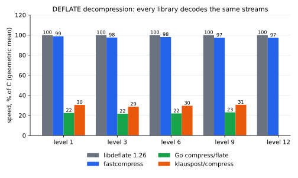
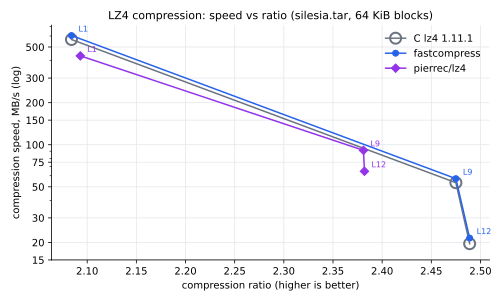

# fastcompress

Pure-Go ports of three C compression libraries, with output byte-identical
to C and speed at or near C's:

| package | port of | API |
|---|---|---|
| `zstd` | [zstd](https://github.com/facebook/zstd) v1.5.7, levels 1 to 22 | the API of [klauspost/compress/zstd](https://github.com/klauspost/compress) |
| `flate`, `gzip`, `zlib` | [libdeflate](https://github.com/ebiggers/libdeflate) v1.26, levels 0 to 12 | the standard library's `compress/*` streams, plus libdeflate's whole-buffer API |
| `lz4` | [lz4](https://github.com/lz4/lz4) v1.11.1, levels 1 to 12 | C's block, HC and frame API, plus `io.Writer`/`io.Reader` |

No cgo and no dependencies. Hot loops have amd64 and arm64 assembly; every
other platform (and the `noasm` build tag) runs the same algorithms in Go.
The decoders are written for untrusted input (see [Safety](#safety)).

```
go get github.com/vahid-sohrabloo/fastcompress
```

## Quick start

```go
import (
	"bytes"

	"github.com/vahid-sohrabloo/fastcompress/gzip"
	"github.com/vahid-sohrabloo/fastcompress/lz4"
	"github.com/vahid-sohrabloo/fastcompress/zstd"
)

// zstd: the klauspost/compress/zstd API; output is C zstd's at the same level.
enc, _ := zstd.NewWriter(nil, zstd.WithEncoderLevel(zstd.SpeedDefault))
compressed := enc.EncodeAll(data, nil)
dec, _ := zstd.NewReader(nil)
plain, err := dec.DecodeAll(compressed, nil)

// gzip: a drop-in for compress/gzip ...
var buf bytes.Buffer
w := gzip.NewWriter(&buf)
w.Write(data)
w.Close()
// ... or libdeflate's whole-buffer API (levels 0 to 12).
c, _ := gzip.NewCompressor(9)
gz, err := c.AppendCompress(nil, data)
out, err := gzip.NewDecompressor().AppendDecompress(nil, gz, len(data))

// lz4: frames through io.Writer / io.Reader, or C's block functions.
zw := lz4.NewWriter(&buf, lz4.WithLevel(9))
zw.Write(data)
zw.Close()
zr := lz4.NewReader(&buf)
```

Each package's documentation has the full API; the sections below cover how
it maps to C, what differs, the tests and the speed.

**Byte-identical to C** means: for the same input and parameters, the
compressed bytes equal the C library's, checked by differential tests
against the C code over the Silesia corpus and fuzzing. The decoders accept
and reject what C accepts and rejects, with C's error class. The few
deliberate differences are listed per package
([zstd](#deliberate-api-differences), [DEFLATE](#deflate-gzip-and-zlib),
[LZ4](#lz4)).

## Speed at a glance

Single-threaded, one core, against the C library each package ports and
the other Go libraries for the same format. Speeds are the geometric mean
of the percentage of C's speed per row; ratios are geometric means too.
Our output is byte-identical to C's, so our ratio is C's; the other Go
libraries produce different output, so compare their speed together with
their ratio. For decompression every library decodes the same C-made data.

**zstd** against C zstd v1.5.7 and klauspost/compress/zstd v1.20.3 (16
Silesia rows per level; [details](#zstd-speed)):

| level | compression: ours / klauspost | ratio: C and ours / klauspost | decompression: ours / klauspost |
|---|---|---|---|
| 1 | 100.3% / 71.7% | 2.877 / 2.844 | 102.1% / 82.7% |
| 3 | 97.8% / 74.5% | 3.146 / 3.087 | 103.8% / 87.6% |
| 7 | 102.4% / 160.4% | 3.453 / 3.236 | 103.8% / 87.4% |
| 11 | 105.6% / 73.8% | 3.591 / 3.483 | 103.0% / 86.7% |
| all | 101.5% / 89.2% | 3.255 / 3.154 | 103.2% / 86.1% |

**DEFLATE** against libdeflate v1.26, Go's `compress/flate` and
klauspost/compress/flate v1.20.3 (15 Silesia rows per level; the Go
libraries have no levels 10 to 12; [details](#speed)):

| level | compression: ours / `compress/flate` / klauspost | ratio: libdeflate and ours / the other two | decompression: ours / `compress/flate` / klauspost |
|---|---|---|---|
| 1 | 101.6% / 88.4% / 105.5% | 2.810 / 2.592 | 98.8% / 22.4% / 30.3% |
| 3 | 99.1% / 106.9% / 127.3% | 2.950 / 2.755 | 97.6% / 21.7% / 28.6% |
| 6 | 98.7% / 105.8% / 125.7% | 3.097 / 2.973 | 97.9% / 21.9% / 29.6% |
| 9 | 97.9% / 54.7% / 62.4% | 3.147 / 3.095 | 97.4% / 23.0% / 30.5% |
| 12 | 118.2% / - / - | 3.253 / - | 97.4% / - / - |

**LZ4** against C lz4 v1.11.1 and pierrec/lz4/v4 v4.1.33 (frames of 4 MiB
blocks; xml, dickens and ooffice; pierrec's levels mapped as described in
[its comparison](#compared-with-pierrecl4)):

| level | compression: ours / pierrec | ratio: C and ours / pierrec | decompression: ours / pierrec |
|---|---|---|---|
| 1 | 104.3% / 58.1% | 2.172 / 2.312 | 102.0% / 76.1% |
| 9 | 106.5% / 111.3% | 3.022 / 2.866 | 100.6% / 78.9% |
| 12 | 105.8% / 175.8% | 3.050 / 2.867 | 100.5% / 79.5% |

## Encoder output

Each `EncoderLevel` runs C's compression level: `SpeedFastest` 1,
`SpeedDefault` 3, `SpeedBetterCompression` 7, `SpeedBestCompression` 11.
The output is byte-identical to C zstd v1.5.7 with the same parameters,
except that `WithEncoderDictRaw` writes its dictionary ID into the frame
header (C writes none for raw content); everything after that field is C's.

## Decoder

`NewReader` and `Decoder` (`DecodeAll`, the streaming `io.Reader`,
`WriteTo`), dictionaries, `ZipDecompressor` and `SnappyConverter` are
ported from C's `zstd_decompress*.c` and `huf_decompress.c`. Output and
error class are checked against C v1.5.7 by differential tests over a
corpus of C-made frames, and fuzz targets compare the paths against each
other (`DecodeAll`, streaming at any input cut, concurrent streaming, and
any `dst` capacity). C errors map to the klauspost sentinels.

### Safety

The decoder is written for untrusted input: corrupt, truncated or hostile
data returns an error, never a panic or an out-of-bounds access, and memory
is bounded by `WithDecoderMaxMemory`. CI enforces this:

- `scripts/decodercheck.sh`: no decoder file imports `unsafe` or calls
  `recover` (one exception: the streaming pipeline re-raises a panic of the
  caller's `io.Reader` on the caller's goroutine). Decoder assembly needs a
  `// BOUNDS:` proof per routine and a fuzz target comparing it with the Go
  code.
- `scripts/fuzz.sh`: every fuzz target runs for 20 s per push (amd64),
  and for 10 minutes nightly on amd64 and arm64, with the assembly on, off
  and (amd64) without BMI2. Every target's seed corpus also runs as a test,
  with and without the `noasm` tag.
- A coverage gate: `zstd_decompress*.go` and `huf_decompress.go` must each
  stay at 95% statement coverage or more.

## Deliberate API differences

- `WithHugePages` is an extension (not a klauspost option): it backs the
  large match tables with transparent huge pages on Linux. Speed only; off by
  default.
- `WithSingleSegment` is accepted and ignored: the frame header follows C's
  automatic choice, so output stays identical to C.
- `WithConcurrentBlocks` and `WithLowerEncoderMem` are accepted and have no
  effect. Encoding is single-threaded per call (C's `nbWorkers = 0`).
  `WithEncoderConcurrency(n)` caps the number of concurrent `EncodeAll` calls;
  streams are never async.
- `BuildDict` returns C's `ZDICT_finalizeDictionary` output. Non-zero
  `Offsets` replace C's starting repcodes {1, 4, 8} (the history is
  zero-padded in front up to the largest); `CompatV155` changes nothing, as
  C's dictionaries already load in zstd v1.5.5.
- `TrainDict`, `TrainDictCover`, `TrainDictFastCover` and `CoverParams`
  are extensions: C's dictionary trainers (`ZDICT_trainFromBuffer`, COVER
  and fastCover), byte-identical to C v1.5.7, parameters included.
- `WithEncoderZstdLevel(n)` is an extension: it runs C compression level
  `n` (1 to 22) directly instead of one of the four `EncoderLevel`s, with
  C's output at that level, including C's long-distance matching, which C
  turns on by itself for levels 16 to 22 with a window of 128 MiB or more
  (level 22 above 64 MiB or for an unknown size, or levels 16 to 21 with a
  `WithWindowSize` of 128 MiB or more).
- `EncoderLevelFromZstd` maps a zstd level to the highest `EncoderLevel`
  whose C level (1, 3, 7, 11) does not exceed it.

## DEFLATE, gzip and zlib

Packages `flate`, `gzip` and `zlib` are a Go port of
[libdeflate](https://github.com/ebiggers/libdeflate) v1.26 (no cgo; amd64
assembly for the hot loops, see below). Each package has two APIs:

- **Streaming, a drop-in for the standard library's `compress/flate`,
  `compress/gzip` and `compress/zlib`**: `NewWriter`, `NewWriterLevel`
  (gzip, zlib), `NewWriterDict` / `NewWriterLevelDict`, `Flush`, `Reset`,
  `HuffmanOnly`, gzip `Header` fields; `NewReader`, `NewReaderDict`,
  `Resetter`, `Multistream`, and the standard library's error types.
  `scripts/apicheck.sh` compares the exported API with the standard
  library's; the extra identifiers are listed in `api/stdlib-*-delta.txt`.
  C has no streaming API, so both sides are new design around the port:
  the `Writer` compresses 1 MiB chunks with 32 KiB of history, and its
  output is byte-identical to libdeflate only when at most 1 MiB is
  written and `Flush` is never called; the `Reader` runs libdeflate's
  decoder and suspends at symbol boundaries. Details in the `flate`
  package documentation.
- **Whole-buffer, libdeflate's own API**, described below.

The whole-buffer API:

- `NewCompressor(level)` with levels -1..12: `NoCompression` (0),
  `BestSpeed` (1) .. `BestCompression` (9), `DefaultCompression` (-1 =
  level 6), and the extensions `Level10`..`Level12` (libdeflate's
  near-optimal parsing). `Compress(dst, src)` into a caller buffer
  (`ErrShortBuffer` if too small; `CompressBound` is always enough) and
  `AppendCompress`. The output is byte-identical to libdeflate's at the
  same level (gzip: one member, no name, MTIME 0, OS 255; zlib: no
  dictionary).
- `NewDecompressor()`: `Decompress(dst, src)` needs the exact
  decompressed size (libdeflate semantics: `ErrShortOutput` /
  `ErrInsufficientSpace` otherwise); `DecompressEx` accepts a larger
  buffer and reports the input and output sizes; `AppendDecompress`
  handles unknown sizes, bounded by `SetMaxOutput` (1 GiB by default)
  against decompression bombs. gzip decodes the first member only; zlib
  rejects preset dictionaries. Inputs are accepted and rejected exactly as
  libdeflate does (differential tests against the C library).
- No allocation per call with reused instances, except when an
  `AppendCompress` / `AppendDecompress` dst lacks the capacity (pool them:
  a level 6 compressor holds about 660 KiB, levels 10..12 about 8.6 MiB,
  a decompressor 13 KiB); instances are not safe for concurrent use. A
  zero `Compressor` is not usable (use `NewCompressor`); a zero
  `Decompressor` is.
- dst must not overlap src (for the `Append` forms: the whole capacity of
  dst); in-place use silently gives bad output or `ErrBadData`.
  `AppendDecompress` allocates its `sizeHint` up front, so do not pass an
  untrusted hint (e.g. a gzip ISIZE) without lowering `SetMaxOutput`.
- The error values are shared by the three packages
  (`gzip.ErrBadData == flate.ErrBadData`).

`HuffmanOnly` (-2) is accepted by the streaming `Writer` only; it has no
libdeflate counterpart, so its output is not compared with libdeflate's.

### Assembly

On amd64 (unless built with `-tags noasm` or `purego`) assembly replaces
the Go code of the decoder's fast loop (only on CPUs with BMI2, as
libdeflate's own BMI2 decoder; other CPUs run the Go loop), the level 1
loop, the greedy / lazy / lazy2 loops of levels 2..9 with the hash-chain
match finder, the sequence writer of the block flush, the match finder's
table init / rebase (SSE2), and, for the near-optimal levels 10..12, the
binary-tree match finding loop (`btMatchLoopAsm`) and the backward
min-cost-path pass (`minCostPathAsm`). The rest of levels 10..12 and
Adler-32 are Go only; CRC-32 is `hash/crc32`. Each routine has a fuzz
target comparing it with the Go code. On arm64 assembly runs the decoder's
fast loop, the level 1 loop, the lazy / lazy2 loop of levels 5..9 and the
hash-chain search (`hcLongestMatchAsm`, which the Go greedy loop of levels
2..4 calls), the match finder's table init / rebase (NEON), and the
binary-tree match finding loop and the min-cost-path pass of levels 10..12;
the block flush and the greedy loop itself are Go there. Every other
architecture runs pure Go.

### Speed

Single-threaded speed of raw DEFLATE against libdeflate v1.26 (built as it
ships, with its BMI2 decoder and SIMD paths on), Go's `compress/flate` and
[klauspost/compress/flate](https://github.com/klauspost/compress) v1.20.3,
over the Silesia corpus: the 12 files whole, plus `silesia.tar` in
independent 16 KiB, 128 KiB and 1 MiB blocks (15 rows per level). Each cell
is the median of three interleaved runs of `bench/gzip/compare.sh`; amd64
assembly on. Treat differences of a few percent as noise. The Go standard
library and klauspost have no levels 10 to 12.


**Compression.** Our output is byte-identical to libdeflate's at every
level (all 75 rows), so speed is the only difference between the two. The
Go standard library and klauspost produce other output (2-9% larger than
libdeflate's at the same level number), so the chart plots speed against
compression ratio. A point further up and to the right is better.

| level | ours, % of libdeflate's speed (geomean) | ours, lowest row | Go `compress/flate`, % of libdeflate | klauspost, % of libdeflate | ratio, libdeflate and ours | ratio, `compress/flate` and klauspost |
|---|---|---|---|---|---|---|
| 1 | 101.6% | 99.5% (ooffice) | 88.4% | 105.5% | 2.810 | 2.592 |
| 3 | 99.1% | 96.5% (nci) | 106.9% | 127.3% | 2.950 | 2.755 |
| 6 | 98.7% | 74.1% (nci; the other 14 rows are 96-101%) | 105.8% | 125.7% | 3.097 | 2.973 |
| 9 | 97.9% | 86.4% (`silesia.tar`, 128 KiB blocks) | 54.7% | 62.4% | 3.147 | 3.095 |
| 12 | 118.2% | 104.3% (sao) | - | - | 3.253 | - |

Ratios are geometric means over the 15 rows of each level. Go 1.27's
`compress/flate` and klauspost produce the same compressed size on 59 of
the 60 rows (on the other, level 9 on `silesia.tar` in 128 KiB blocks,
the ratios are 3.046 and 3.045), so they share a ratio column; klauspost is the faster of the two. At levels 3 and 6 both
are faster than libdeflate and compress 4-7% less.



**Decompression.** Every library decodes the same libdeflate streams, so
the bars compare like with like. Geometric mean of the percentage of
libdeflate's speed:

| level | ours | Go `compress/flate` | klauspost |
|---|---|---|---|
| 1 | 98.8% | 22.4% | 30.3% |
| 3 | 97.6% | 21.7% | 28.6% |
| 6 | 97.9% | 21.9% | 29.6% |
| 9 | 97.4% | 23.0% | 30.5% |
| 12 | 97.4% | - | - |

Our lowest decompression row is samba at level 3 (91.6%). We decompress
about 4.4 times as fast as the Go standard library and 3.3 times as fast as
klauspost.

The decoder's margin against libdeflate depends on the CPU and on code
layout: the fast loop's alignment is tuned, and on another CPU the same
code measured 100.2-100.6% of libdeflate. The pure-Go build (`-tags noasm`)
is slower and is not measured here. The charts are drawn from the
`bench/gzip/compare.sh` output by `bench/plot.py`.

**arm64.** On an arm64 server core (the same method on dickens, mozilla,
ooffice, xml and x-ray whole; libdeflate built from source with gcc -O2),
compression is 97.0% of libdeflate's speed at level 1, 97.5% at 6, 100.9%
at 9 and 113.0% at 12 (geomean; the lowest row is level 1 on x-ray,
93.5%), and decompression 97.4-98.8% by level (rows 95.6-102.2%). The
pure-Go code ran at 57-76% of libdeflate for compression and 52-56% for
decompression on the same core.

### Tests

The tests compare against libdeflate v1.26 run as a C subprocess
(`ref/fetch.sh`, then `make -C ref/ldref`). The full suite is heavy (whole
Silesia files and `silesia.tar` blocks at every level, against C), so run
it through `scripts/deflate-test.sh`, which serialises runs with `flock`
and caps each one with `systemd-run` (6G `MemoryMax`, no swap,
`GOMEMLIMIT` 4GiB by default):

    scripts/deflate-groups.sh -v -run FILE...      # quick tier: the tests of the changed files
    scripts/deflate-test.sh -t quick               # whole internal/deflate package, -short
    scripts/deflate-test.sh -t full -a on,off,nobmi2 lazy nopt rest equiv dec other
    scripts/deflate-test.sh -t full noasm flate gzip zlib creftest

On one 20-thread laptop a full-tier pass of internal/deflate takes about
21 to 25 minutes per assembly mode. CI splits internal/deflate into those six
partitions (`scripts/deflate-groups.sh -regex`), each a matrix job on amd64
and arm64 (default build, then `-tags noasm`), plus jobs for the other
packages and for 386 / race `-short`. Details:
[scripts/README-deflate-tests.md](scripts/README-deflate-tests.md).

## zstd speed

Single-threaded speed against C `zstd` v1.5.7 (`zstd -b -T1`) and
[klauspost/compress/zstd](https://github.com/klauspost/compress) v1.20.3,
over the Silesia corpus: the 12 files whole, plus `silesia.tar` in
independent 16 KiB, 128 KiB, 1 MiB and 4 MiB blocks (16 rows per level).
Checksums are off, and each cell is the median of three interleaved runs
of `bench/compare.sh -k`. Treat differences of a few percent as noise.


**Compression.** Our output is byte-identical to C's, so speed is the only
difference between the two. klauspost produces different output: its named
levels are its own and do not match C's, so the chart plots speed against
compression ratio instead of speed alone. A point further up and to the
right is better.

| level | ours, % of C's speed (geomean) | ours, lowest row | klauspost, % of C's speed | ratio, C and ours | ratio, klauspost |
|---|---|---|---|---|---|
| 1 | 100.3% | 97.2% (x-ray) | 71.7% | 2.877 | 2.844 |
| 3 | 97.8% | 81.2% (xml)* | 74.5% | 3.146 | 3.087 |
| 7 | 102.4% | 98.1% (`silesia.tar`, 16 KiB blocks) | 160.4% | 3.453 | 3.236 |
| 11 | 105.6% | 95.2% (reymont) | 73.8% | 3.591 | 3.483 |
| all | 101.5% | | 89.2% | 3.255 | 3.154 |

Ratios are geometric means over the 16 rows of each level. klauspost's
`SpeedBetterCompression` (level 7) is faster than C's level 7 because it
compresses less (6.3% below C's ratio); its other levels are 25-28% slower
than C and compress 1-3% less.

\* The xml row at level 3 swings between runs on a shared machine (81% in
this run, 87% and 98.5% in earlier ones); on a quiet core it measures
about 101% of C. Without it, level 3's lowest row is 94.2% (`silesia.tar`,
4 MiB blocks).


**Decompression.** Every library decodes the same frames (ours, which are
C's), so the bars compare like with like. Geometric mean of the
percentage of C's speed:

| level | ours | klauspost |
|---|---|---|
| 1 | 102.1% | 82.7% |
| 3 | 103.8% | 87.6% |
| 7 | 103.8% | 87.4% |
| 11 | 103.0% | 86.7% |
| all | 103.2% | 86.1% |

Our lowest decompression row is `silesia.tar` in 16 KiB blocks at level 1
(95.8%). klauspost falls to about 66% of C on the 128 KiB and 16 KiB rows.

**Higher levels (13 to 22).** Ported from C as well (btultra, btultra2, the
post-block splitter and long-distance matching), reached with
`WithEncoderZstdLevel`; the output is C's. Speed as a percentage of C's, on
four inputs (xml, dickens, ooffice and `silesia.tar` in 1 MiB blocks):

| level | compression | decompression |
|---|---|---|
| 13 | 95-100% | 100-105% |
| 16 | 103-112% | 101-104% |
| 19 | 87-114% | 101-105% |
| 22 | 97-132% | 102-105% |

Expect other CPUs to give different numbers. The charts are drawn from the
`bench/compare.sh` output by `bench/plot.py`.

**arm64.** On an arm64 server core (the same method on dickens, mozilla,
ooffice, xml and x-ray whole, C built from source with gcc -O2), compression
is 88.7% of C's speed at level 1, 88.9% at 3, 89.1% at 7, 92.3% at 11 and
87.4% at 19 (geomean; rows 81-99%), decompression 99.9%, 98.3%, 93.3%,
92.0% and 92.9%. Most of the remaining gap at levels 1 to 7 is in the match
finders and the sequence encoder, which are in arm64 assembly already; the
optimal parser is Go there (amd64 has it in assembly for levels 16 and 17),
with the binary-tree match finder in assembly. C's own speed varied by up to
about 8% between runs on that machine.

## LZ4

Package `lz4` is a port of [lz4](https://github.com/lz4/lz4) v1.11.1
(`lz4.c`, `lz4hc.c`, `lz4frame.c`): the block format, the fast compressor,
the high compression levels 2 to 12 and the frame format. Every compressor
produces C's bytes for the same calls in the same order; the decoders accept
and reject what C accepts and rejects, with C's error class.

**Blocks** (C's API, with `dst` as a buffer whose length is the capacity):

- `CompressFast(dst, src, acceleration)` / `CompressDefault` /
  `CompressDestSize` (`LZ4_compress_fast`, `_default`, `_destSize`), and
  `CompressHC(dst, src, level)` / `CompressHCDestSize` (`LZ4_compress_HC`,
  levels 2 to 12: LZ4MID at 2, hash chains at 3 to 9, the optimal parser at
  10 to 12). `CompressBound(n)` bytes are always enough; otherwise 0 means
  the block did not fit.
- `Stream` (`LZ4_stream_t`) and `StreamHC` (`LZ4_streamHC_t`): independent
  blocks that reuse the tables (`CompressFast`, `Compress`), streaming with
  `CompressFastContinue` / `CompressContinue` (prefix and external
  dictionary modes), `LoadDict`, `LoadDictSlow`, `AttachDictionary`,
  `SaveDict`, `FavorDecompressionSpeed`.
- `DecompressSafe`, `DecompressSafePartial` and the `UsingDict` variants
  return `ErrCorrupt`, `ErrDstTooSmall` or `ErrOffset` (C's -1, -2, -3).

C chooses between its prefix and external-dictionary modes by comparing
pointers. Here an input continues the history only when both are parts of
one slice (the history's capacity reaches the input); two separate
allocations that happen to be adjacent are compressed as an external
dictionary, where C would use the prefix. Both are valid; only the bytes
differ from C's in that case.

**Frames** (`lz4frame.c`):

- `CompressFrame` / `AppendFrame` / `CompressFrameUsingCDict`
  (`LZ4F_compressFrame`), `FrameCompressor` (`LZ4F_compressBegin`, `Update`,
  `Flush`, `End`) and `Writer` (an `io.WriteCloser`: each `Write` is one
  `LZ4F_compressUpdate`, so the frame is C's for the same sequence of writes
  and flushes). `Preferences` has C's fields: level, block size ID, linked or
  independent blocks, block and content checksums, content size, dictionary
  ID, `AutoFlush`, `FavorDecSpeed`, `NbWorkers`; `NewCDict`, `WithDict`,
  `WithCDict` for dictionaries, `WriteUncompressed` for uncompressed blocks,
  `UpdateStable` for input that stays until the next flush.
- Multi-threaded frames (C's `nbWorkers`, `lz4 -T#`): with
  `Preferences.NbWorkers` (or `WithConcurrency(n)` on a `Writer`) the
  content is cut into jobs at fixed positions (1 MB, or one block when
  larger, restarting at each flush), compressed by up to `NbWorkers`
  goroutines and emitted in order. The frame depends only on the content
  and the flush points, never on the number of workers or the scheduling:
  with independent blocks it is the single-threaded frame, with linked
  blocks it is C's multi-threaded frame (each job restarts with the
  previous 64 KB as dictionary). Output lags behind input: `Flush` and
  `Close`/`End` emit the jobs in flight; with `FrameCompressor`,
  `CompressBoundFrame` counts them (C emits them over several calls
  instead).
- `AppendDecompressFrame(dst, src, dict)` and `Reader` (`io.Reader`,
  `io.WriterTo`) decode concatenated frames and skip skippable frames, with
  C's header checks, checksums and error classes (`ErrFrameType`,
  `ErrHeaderChecksum`, `ErrBlockChecksum`, `ErrContentChecksum`,
  `ErrFrameSize`, `ErrDecompressionFailed`, `io.ErrUnexpectedEOF` for a
  truncated frame, ...).

Usage:

    dst := make([]byte, lz4.CompressBound(len(src)))
    n := lz4.CompressFast(dst, src, 1)
    out := make([]byte, len(src))
    m, err := lz4.DecompressSafe(out, dst[:n])

    w := lz4.NewWriter(f, lz4.WithLevel(9))
    io.Copy(w, r)
    w.Close()

    content, err := lz4.AppendDecompressFrame(nil, frame, nil)

Not ported: `LZ4_decompress_fast` (unsafe by design), the streaming block decoder
(`LZ4_decompress_safe_continue`; the frame decoders cover streams), the
legacy frame format of the `lz4` command, and the `lz4file.h` API.

### Safety

The decoder files (`lz4_decompress*.go`, `lz4frame_decompress*.go`) import
no `unsafe` and call no `recover` (`scripts/decodercheck.sh`); malformed
input returns an error, never a panic or an out-of-bounds access. The
decoder's assembly has a `// BOUNDS:` proof and a fuzz target comparing it
with the Go loop. `FuzzDecompress` and `FuzzDecompressFrame` compare every
result with C's decoders.

### Assembly

On amd64 (unless built with `-tags noasm` or `purego`) assembly runs the
decoder's fast loop (C's `LZ4_FAST_DEC_LOOP` part, without external
dictionary; linked frames decode with the history in the output, in
prefix mode), the fast compressor's main loop (one-shot with byU16 and
byU32 tables, the streaming prefix and external-dictionary modes with C's
resume-in-prefix split, the attached dictionary (`dictCtx`) of small
blocks, and `destSize`; limited or unlimited output), the LZ4MID main loop
of level 2, and the whole parsers of levels 3 to 12:
`LZ4HC_compress_hashChain` (levels 3 to 9) and
`LZ4HC_compress_optimal` (10 to 12), with the match search (table
insertion, candidate loop, pattern analysis, `chainSwap`) and the price
updates in the same routine. The LZ4MID loop and the parsers cover every
mode of C's: a prefix alone, an external dictionary (linked blocks, and
CDict frames, whose dictionary state C copies into the stream), an
attached dictionary (`dictCtx`: blocks below `dictCopyMin`, and LZ4MID
with any CDict), `favorDecSpeed`, and `destSize` (the assembly stops at
the sequence that does not fit, which Go encodes as C does). Each mode is
a separate routine assembled from one source (`#ifdef` variants), so the
prefix-only loops keep their instruction stream. Each falls back to Go
where C's code takes a path the assembly does not cover, and each has a
fuzz target comparing it with the Go code.
Baseline instructions only (SSE2; no BMI2 or AVX2 needed): 16-byte match
compares measured slower than 8-byte ones on the short matches that
dominate, except in LZ4MID's count past the first 8 bytes.
On arm64 assembly runs the decoder's fast loop, the fast compressor's
main loop (one-shot, the streaming prefix mode with its resume and
`destSize`; external and attached dictionaries run the Go loop), the LZ4MID
loop without dictionary, the candidate loop of the hash chain search, and
the whole hash chain and optimal parsers for a prefix without dictionary and
without `favorDecSpeed` (the other modes run the Go parsers with the
assembly candidate loop). The other architectures run the Go code.

### Speed

Single-threaded frame speed against C `lz4` v1.11.1 (`lz4 -b<L> -T1 -B4M`:
one frame per file, 4 MiB independent blocks, no checksums) on three Silesia
files, and on `silesia.tar` in 64 KiB blocks (`-B64K`), measured with
`bench/compare-lz4.sh` (median of three interleaved runs, each the best
mean of ~1 s windows over 3 s, pinned to one core). The output is
byte-identical (equal ratios on every row). Treat a few percent as noise
(the closest rows, level 1 on xml and the decoder on dickens, are within
it); other CPUs give other numbers.

| level | xml | dickens | ooffice | geomean | silesia.tar, 64 KiB |
|---|---|---|---|---|---|
| 1 (fast) compression | 101.0% | 102.4% | 106.0% | 103.1% | 106.8% |
| 2 (LZ4MID) compression | 101.8% | 102.2% | 103.8% | 102.6% | 103.1% |
| 3 (hash chain) compression | 107.7% | 111.3% | 109.9% | 109.6% | 111.5% |
| 4 compression | 109.3% | 115.5% | 112.2% | 112.3% | 112.7% |
| 5 compression | 108.9% | 115.9% | 112.2% | 112.3% | 112.5% |
| 6 compression | 107.9% | 112.7% | 111.5% | 110.7% | 111.2% |
| 7 compression | 105.9% | 110.4% | 110.5% | 108.9% | 110.0% |
| 8 compression | 104.8% | 108.6% | 109.9% | 107.7% | 108.8% |
| 9 (hash chain) compression | 104.2% | 107.5% | 107.7% | 106.5% | 107.7% |
| 10 (optimal) compression | 104.7% | 104.0% | 108.1% | 105.6% | 108.5% |
| 11 compression | 104.6% | 103.6% | 108.6% | 105.6% | 108.6% |
| 12 (optimal) compression | 106.2% | 104.2% | 109.7% | 106.7% | 110.2% |
| 1 decompression | 104.4% | 101.9% | 103.4% | 103.2% | 102.4% |
| 9 decompression | 102.3% | 101.4% | 103.0% | 102.2% | 101.7% |
| 12 decompression | 102.5% | 101.1% | 102.0% | 101.9% | 102.1% |

The HC levels gain most from running the whole parser in one routine: C
inlines `LZ4HC_InsertAndGetWiderMatch` into each parser, and so does the
assembly. C's `-T1` runs its job mode with one worker thread, which costs C
about 2% against `--single-thread`. The pure-Go build (`-tags noasm`) is
slower (measured before the assembly: 40 to 55% of C at level 1, 15 to 25%
for decoding).

**arm64.** On an arm64 server core (the same method with 4 MiB blocks on
dickens, mozilla, ooffice, xml and x-ray, C built from source with gcc -O2),
compression is 102.0% of C's speed at level 1, 100.8% at 2, 104.8% at 9 and
103.6% at 12 (geomean; the lowest row is level 2 on dickens, 92.7%), and
decompression 97.9% (level 1) and 98.3% (level 9); the pure-Go code ran at
37-59% of C for compression and 28-30% for decompression on the same core.

The other frame modes, against C with `--single-thread` (the same method;
xml, dickens and ooffice; equal ratios on every row): linked blocks
(`-BD`), a dictionary (`-D`: 64 KiB from the middle of the file, digested
once into a CDict; with 4 MiB blocks C copies the dictionary state into the
stream at every level but 2, which searches the attached dictionary for
the whole block), and `--favor-decSpeed`. The lowest rows, level 1 with a
dictionary on xml in 4 MiB blocks (98.5%, four runs between 97.8 and
98.7%) and `favorDecSpeed` at level 10 on xml (98.9 to 99.3%), are below C
by about 1%; cells within 2% of 100% are noise-level.

| mode, level | 4 MiB: xml | dickens | ooffice | 64 KiB: xml | dickens | ooffice |
|---|---|---|---|---|---|---|
| linked, 1 | 101.5% | 101.7% | 102.0% | 101.2% | 102.2% | 100.6% |
| linked, 2 | 100.4% | 100.6% | 103.3% | 100.1% | 100.3% | 102.8% |
| linked, 4 | 107.2% | 112.1% | 108.9% | 106.8% | 107.5% | 109.2% |
| linked, 9 | 103.8% | 106.7% | 107.4% | 103.9% | 106.4% | 106.3% |
| linked, 12 | 104.4% | 103.0% | 107.7% | 104.1% | 103.0% | 108.2% |
| dictionary, 1 | 98.5% | 100.2% | 101.5% | 104.5% | 100.3% | 103.1% |
| dictionary, 2 | 101.0% | 100.9% | 106.0% | 103.2% | 102.4% | 105.3% |
| dictionary, 4 | 104.8% | 112.1% | 109.2% | 103.9% | 110.6% | 108.5% |
| dictionary, 9 | 103.5% | 106.6% | 105.4% | 103.7% | 105.8% | 104.4% |
| dictionary, 12 | 103.8% | 103.1% | 107.3% | 103.8% | 100.7% | 105.7% |
| favorDecSpeed, 10 | 99.3% | 100.6% | 103.8% | 98.9% | 100.4% | 103.9% |
| favorDecSpeed, 11 | 100.3% | 100.0% | 104.3% | 99.5% | 100.0% | 104.3% |
| favorDecSpeed, 12 | 102.3% | 100.0% | 104.4% | 102.1% | 100.0% | 105.2% |
| linked, 1 decompression | 103.6% | 101.1% | 103.2% | 101.4% | 100.5% | 98.8% |
| linked, 9 decompression | 103.4% | 101.8% | 104.0% | 100.8% | 101.0% | 101.0% |

Before this assembly the same rows measured 58 to 64% (level 2 with a
dictionary), 57 to 87% (HC levels with a dictionary), 62 to 81%
(`favorDecSpeed`) and 70 to 98% (HC levels, linked 64 KiB blocks).

Multi-threaded frames (`NbWorkers`, against C's `lz4 -T<n>`, which reads
its stable input in place as `UpdateStable` does) on `silesia.tar`, 64 KiB
blocks, both pinned to the same 8 cores (one thread each, no SMT
siblings), median of three interleaved runs (MB/s, Go then C, and Go's %
of C); the ratios are equal, linked frames included (C's job output):

| threads | independent, level 1 | independent, level 9 | linked, level 1 | linked, level 9 |
|---|---|---|---|---|
| 1 | 398 / 383 (103.8%) | 21.5 / 19.4 (110.8%) | 379 / 366 (103.7%) | 21.0 / 19.2 (109.4%) |
| 2 | 807 / 680 (118.7%) | 41.7 / 38.4 (108.6%) | 749 / 723 (103.6%) | 42.2 / 37.7 (111.9%) |
| 4 | 1534 / 1483 (103.4%) | 79.0 / 74.8 (105.6%) | 1492 / 1413 (105.6%) | 80.9 / 75.1 (107.7%) |
| 8 | 2543 / 2576 (98.7%) | 147 / 145 (101.2%) | 2485 / 2409 (103.1%) | 147 / 145 (101.0%) |

Level 9 scales 6.8 times from 1 to 8 threads (C 7.5 times, from a slower
start); level 1 at 8 threads (2.5 GB/s) is within noise of C. The 2-thread
independent row's C value was low in each of its runs.

#### Compared with pierrec/lz4

[pierrec/lz4/v4](https://github.com/pierrec/lz4) v4.1.33 is timed by
`bench/compare-lz4.sh -p` (`bench/lz4`, a nested module) with the same
method, interleaved with C and ours: one reused `lz4.Writer` per pass
(independent blocks, no checksums, `ConcurrencyOption(1)`, 4 MiB writes),
and for decompression one reused `lz4.Reader` decoding our frames, which
are C's, so all three decoders see the same input. pierrec's levels are its
own: level 1 runs its default `Fast` compressor, level 9 `CompressorHC`
`Level1` (up to 512 candidates per position, the nearest to C's 256 at
level 9) and level 12 `Level9` (its highest; pierrec has no optimal
parser). Its output differs from C's, so its ratio is shown. A separate
run from the table above (median of three interleaved runs, 3 s each).



| file, level | compression: ours / pierrec (% of C) | ratio: C and ours / pierrec | decompression: ours / pierrec (% of C) |
|---|---|---|---|
| xml, 1 | 102.0% / 72.0% | 4.542 / 4.715 | 102.9% / 76.1% |
| xml, 9 | 104.4% / 98.5% | 6.928 / 6.435 | 101.4% / 72.8% |
| xml, 12 | 105.3% / 179.4% | 7.021 / 6.442 | 101.4% / 74.1% |
| dickens, 1 | 103.8% / 58.7% | 1.591 / 1.824 | 100.4% / 79.1% |
| dickens, 9 | 107.4% / 104.1% | 2.295 / 2.186 | 98.6% / 82.5% |
| dickens, 12 | 103.6% / 147.9% | 2.324 / 2.187 | 99.3% / 82.9% |
| ooffice, 1 | 107.1% / 46.4% | 1.418 / 1.437 | 102.6% / 73.2% |
| ooffice, 9 | 107.8% / 134.4% | 1.735 / 1.673 | 101.7% / 81.8% |
| ooffice, 12 | 108.7% / 204.6% | 1.739 / 1.673 | 100.9% / 81.8% |
| `silesia.tar` 64 KiB, 1 | 106.8% / 76.4% | 2.084 / 2.093 | 101.2% / 77.5% |
| `silesia.tar` 64 KiB, 9 | 106.9% / 170.5% | 2.475 / 2.381 | 101.2% / 75.7% |
| `silesia.tar` 64 KiB, 12 | 109.7% / 329.6% | 2.489 / 2.382 | 100.9% / 75.4% |

pierrec's `Fast` compresses more than C's level 1 (6.4% higher ratio,
geomean of the 4 MiB rows) at 58% of its speed. Its HC levels compress 5-6% less than C's levels 9
and 12 and are faster on most rows (geomean 111.3% and 175.8% of C);
`Level1` and `Level9` give almost the same ratio. It decodes at 73-83% of
C's speed. The chart is drawn from the `silesia.tar` rows by
`bench/plot.py`.

### Tests

The tests compare against lz4 v1.11.1 run as a C subprocess
(`ref/fetch.sh`, then `make -C ref/lz4ref`): every encoder on the creftest
inputs and the Silesia corpus (the fast compressor at several accelerations
and with reused tables, every HC level 0 to 13 with and without
`favorDecSpeed`, streaming in prefix, external-dictionary and saved-history
layouts with loaded, slow-loaded and attached dictionaries, limited
capacities and `destSize`), frames for 64 preference sets and plans of
writes, flushes and uncompressed writes with raw and digested dictionaries,
multi-threaded frames (1, 3 and 8 workers, one-shot, `Writer` and
`UpdateStable`, against C's frames with `nbWorkers`), and the decoders on
valid, truncated and mutated blocks and frames. Fuzz targets compare the
assembly with the Go code in every compression mode (`FuzzHCDictAsmEquiv`,
`FuzzFastDictAsmEquiv` and the others), the multi-threaded frames across
worker counts (`FuzzFrameMT`), and the decoders and encoders with C's;
the concurrent paths run under the race detector. `go test -short ./lz4`
runs a subset; the full run takes about 40 minutes.

## Credits

- `zstd` is a port of [zstd](https://github.com/facebook/zstd) v1.5.7, by
  Yann Collet and the zstd contributors (Copyright Meta Platforms, Inc. and
  affiliates; BSD 3-Clause, see [LICENSE](LICENSE)).
- `flate`, `gzip` and `zlib` are a port of
  [libdeflate](https://github.com/ebiggers/libdeflate) v1.26, by Eric
  Biggers and the libdeflate contributors (MIT, see
  [internal/deflate/NOTICE](internal/deflate/NOTICE)).
- `lz4` is a port of [lz4](https://github.com/lz4/lz4) v1.11.1 (`lz4.c`,
  `lz4hc.c`, `lz4frame.c`), by Yann Collet and the lz4 contributors (BSD
  2-Clause, see [lz4/NOTICE](lz4/NOTICE)); no code from pierrec/lz4 is used.
- The `zstd` API follows
  [klauspost/compress/zstd](https://github.com/klauspost/compress) so that it
  can replace it; no code from that project is used.
