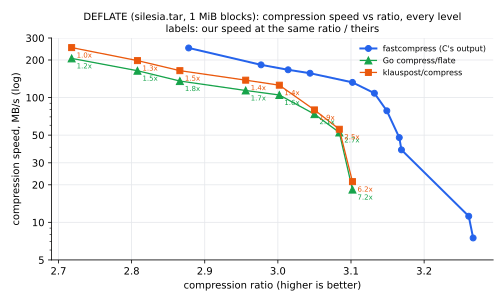
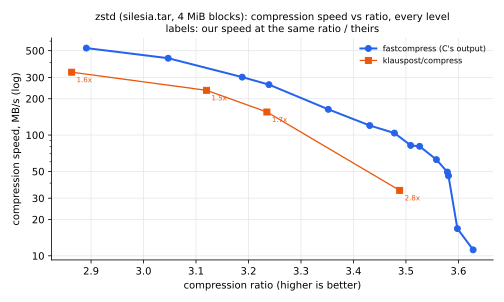
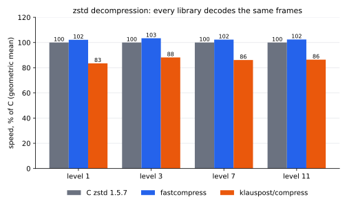

# fastcompress

Pure-Go compression, ported from C. `zstd` is a port of libzstd v1.5.7 that
exposes the public API of `klauspost/compress/zstd`; `flate`, `gzip` and
`zlib` are a port of libdeflate v1.26. No cgo and no dependencies.

Status: work in progress.

- **Phase 1, the encoder, is done:** `NewWriter`, `Encoder` (`EncodeAll`,
  the streaming `io.WriteCloser`), `EncodeTo`, `ZipCompressor` and the
  `EOption`s.
- **Phase 2, the decoder, is done:** `NewReader`, `Decoder` (`DecodeAll`,
  the streaming reader), the dictionary and trainer functions, and the zip and
  snappy helpers. Every identifier of `klauspost/compress/zstd` is exported.
  Compression is at 100.3% and decompression at 102.6% of C libzstd v1.5.7's
  speed overall (see [zstd speed](#zstd-speed)).

## Encoder output

Each `EncoderLevel` runs C's compression level: `SpeedFastest` 1,
`SpeedDefault` 3, `SpeedBetterCompression` 7, `SpeedBestCompression` 11.
The output is byte-identical to C zstd v1.5.7 with the same parameters,
except that `WithEncoderDictRaw` writes its dictionary ID into the frame
header (C writes none for raw content); everything after that field is C's.

## Decoder

`NewReader` and `Decoder` (`DecodeAll`, the streaming `io.Reader`,
`WriteTo`), dictionaries, `ZipDecompressor` and `SnappyConverter` are
ported from C's `zstd_decompress*.c` and `huf_decompress.c`. Output and
error class are checked against C v1.5.7 by differential tests over a
corpus of C-made frames, and fuzz targets compare the paths against each
other (`DecodeAll`, streaming at any input cut, concurrent streaming, and
any `dst` capacity). C errors map to the klauspost sentinels.

### Safety

The decoder is written for untrusted input: corrupt, truncated or hostile
data returns an error, never a panic or an out-of-bounds access, and memory
is bounded by `WithDecoderMaxMemory`. CI enforces this:

- `scripts/decodercheck.sh`: no decoder file imports `unsafe` or calls
  `recover` (one exception: the streaming pipeline re-raises a panic of the
  caller's `io.Reader` on the caller's goroutine). Decoder assembly needs a
  `// BOUNDS:` proof per routine and a fuzz target comparing it with the Go
  code.
- `scripts/fuzz.sh`: every fuzz target runs for 20 s per push (amd64),
  and for 10 minutes nightly on amd64 and arm64, with the assembly on, off
  and (amd64) without BMI2. Every target's seed corpus also runs as a test,
  with and without the `noasm` tag.
- A coverage gate: `zstd_decompress*.go` and `huf_decompress.go` must each
  stay at 95% statement coverage or more.

## Deliberate API differences

- `WithHugePages` is an extension (not a klauspost option): it backs the
  large match tables with transparent huge pages on Linux. Speed only; off by
  default.
- `WithSingleSegment` is accepted and ignored: the frame header follows C's
  automatic choice, so output stays identical to C.
- `WithConcurrentBlocks` and `WithLowerEncoderMem` are accepted and have no
  effect. Encoding is single-threaded per call (C's `nbWorkers = 0`).
  `WithEncoderConcurrency(n)` caps the number of concurrent `EncodeAll` calls;
  streams are never async.
- `BuildDict` returns C's `ZDICT_finalizeDictionary` output. Non-zero
  `Offsets` replace C's starting repcodes {1, 4, 8} (the history is
  zero-padded in front up to the largest); `CompatV155` changes nothing, as
  C's dictionaries already load in zstd v1.5.5.
- `TrainDict`, `TrainDictCover`, `TrainDictFastCover` and `CoverParams`
  are extensions: C's dictionary trainers (`ZDICT_trainFromBuffer`, COVER
  and fastCover), byte-identical to C v1.5.7, parameters included.
- `WithEncoderZstdLevel(n)` is an extension: it runs C compression level
  `n` (1 to 22) directly instead of one of the four `EncoderLevel`s, with
  C's output at that level, including C's long-distance matching, which C
  turns on by itself for levels 16 to 22 with a window of 128 MiB or more
  (level 22 above 64 MiB or for an unknown size, or levels 16 to 21 with a
  `WithWindowSize` of 128 MiB or more).
- `EncoderLevelFromZstd` maps a zstd level to the highest `EncoderLevel`
  whose C level (1, 3, 7, 11) does not exceed it.

## DEFLATE, gzip and zlib

Packages `flate`, `gzip` and `zlib` are a Go port of
[libdeflate](https://github.com/ebiggers/libdeflate) v1.26 (no cgo; amd64
assembly for the hot loops, see below). Each package has two APIs:

- **Streaming, a drop-in for the standard library's `compress/flate`,
  `compress/gzip` and `compress/zlib`**: `NewWriter`, `NewWriterLevel`
  (gzip, zlib), `NewWriterDict` / `NewWriterLevelDict`, `Flush`, `Reset`,
  `HuffmanOnly`, gzip `Header` fields; `NewReader`, `NewReaderDict`,
  `Resetter`, `Multistream`, and the standard library's error types.
  `scripts/apicheck.sh` compares the exported API with the standard
  library's; the extra identifiers are listed in `api/stdlib-*-delta.txt`.
  C has no streaming API, so both sides are new design around the port:
  the `Writer` compresses 1 MiB chunks with 32 KiB of history, and its
  output is byte-identical to libdeflate only when at most 1 MiB is
  written and `Flush` is never called; the `Reader` runs libdeflate's
  decoder and suspends at symbol boundaries. Details in the `flate`
  package documentation.
- **Whole-buffer, libdeflate's own API**, described below.

The whole-buffer API:

- `NewCompressor(level)` with levels -1..12: `NoCompression` (0),
  `BestSpeed` (1) .. `BestCompression` (9), `DefaultCompression` (-1 =
  level 6), and the extensions `Level10`..`Level12` (libdeflate's
  near-optimal parsing). `Compress(dst, src)` into a caller buffer
  (`ErrShortBuffer` if too small; `CompressBound` is always enough) and
  `AppendCompress`. The output is byte-identical to libdeflate's at the
  same level (gzip: one member, no name, MTIME 0, OS 255; zlib: no
  dictionary).
- `NewDecompressor()`: `Decompress(dst, src)` needs the exact
  decompressed size (libdeflate semantics: `ErrShortOutput` /
  `ErrInsufficientSpace` otherwise); `DecompressEx` accepts a larger
  buffer and reports the input and output sizes; `AppendDecompress`
  handles unknown sizes, bounded by `SetMaxOutput` (1 GiB by default)
  against decompression bombs. gzip decodes the first member only; zlib
  rejects preset dictionaries. Inputs are accepted and rejected exactly as
  libdeflate does (differential tests against the C library).
- No allocation per call with reused instances, except when an
  `AppendCompress` / `AppendDecompress` dst lacks the capacity (pool them:
  a level 6 compressor holds about 660 KiB, levels 10..12 about 8.6 MiB,
  a decompressor 13 KiB); instances are not safe for concurrent use. A
  zero `Compressor` is not usable (use `NewCompressor`); a zero
  `Decompressor` is.
- dst must not overlap src (for the `Append` forms: the whole capacity of
  dst); in-place use silently gives bad output or `ErrBadData`.
  `AppendDecompress` allocates its `sizeHint` up front, so do not pass an
  untrusted hint (e.g. a gzip ISIZE) without lowering `SetMaxOutput`.
- The error values are shared by the three packages
  (`gzip.ErrBadData == flate.ErrBadData`).

`HuffmanOnly` (-2) is accepted by the streaming `Writer` only; it has no
libdeflate counterpart, so its output is not compared with libdeflate's.

### Assembly

On amd64 (unless built with `-tags noasm` or `purego`) assembly replaces
the Go code of the decoder's fast loop (only on CPUs with BMI2, as
libdeflate's own BMI2 decoder; other CPUs run the Go loop), the level 1
loop, the greedy / lazy / lazy2 loops of levels 2..9 with the hash-chain
match finder, the sequence writer of the block flush, the match finder's
table init / rebase (SSE2), and, for the near-optimal levels 10..12, the
binary-tree match finding loop (`btMatchLoopAsm`) and the backward
min-cost-path pass (`minCostPathAsm`). The rest of levels 10..12 and
Adler-32 are Go only; CRC-32 is `hash/crc32`. Each routine has a fuzz
target comparing it with the Go code. arm64 and every other architecture
run pure Go: there is no arm64 assembly, and arm64 is only tested on CI.

### Speed

Single-threaded speed of raw DEFLATE against libdeflate v1.26 (built as it
ships, with its BMI2 decoder and SIMD paths on), Go's `compress/flate` and
[klauspost/compress/flate](https://github.com/klauspost/compress) v1.20.3,
over the Silesia corpus: the 12 files whole, plus `silesia.tar` in
independent 16 KiB, 128 KiB and 1 MiB blocks (15 rows per level). Each cell
is the median of three interleaved runs of `bench/gzip/compare.sh`; amd64
assembly on. Treat differences of a few percent as noise. The Go standard
library and klauspost have no levels 10 to 12.

**Compression.** Our output is byte-identical to libdeflate's at every
level (all 75 rows), so speed is the only difference between the two. The
Go standard library and klauspost produce other output (2-9% larger than
libdeflate's at the same level number), so the chart plots speed against
compression ratio. A point further up and to the right is better.

| level | % of libdeflate's speed (geomean) | lowest row |
|---|---|---|
| 1 | 101.6% | 99.5% (ooffice) |
| 3 | 99.1% | 96.5% (nci) |
| 6 | 98.7% | 74.1% (nci; the other 14 rows are 96-101%) |
| 9 | 98.0% | 86.4% (`silesia.tar`, 128 KiB blocks) |
| 12 | 118.2% | 104.3% (sao) |

**Decompression.** Every library decodes the same libdeflate streams, so
the bars compare like with like. Geometric mean of the percentage of
libdeflate's speed:

| level | ours | Go `compress/flate` | klauspost |
|---|---|---|---|
| 1 | 98.8% | 22.4% | 30.3% |
| 3 | 97.6% | 21.7% | 28.6% |
| 6 | 97.9% | 21.9% | 29.6% |
| 9 | 97.4% | 23.0% | 30.5% |
| 12 | 97.4% | - | - |

Our lowest decompression row is samba at level 3 (91.6%). We decompress
about 4.4 times as fast as the Go standard library and 3.3 times as fast as
klauspost.

The decoder's margin against libdeflate depends on the CPU and on code
layout: the fast loop's alignment is tuned, and on another CPU the same
code measured 100.2-100.6% of libdeflate. The pure-Go build (`-tags noasm`)
is slower and is not measured here; arm64 has not been benchmarked. The
charts are drawn from the `bench/gzip/compare.sh` output by
`bench/plot.py`.

### Tests

The tests compare against libdeflate v1.26 run as a C subprocess
(`ref/fetch.sh`, then `make -C ref/ldref`). The full suite is heavy (whole
Silesia files and `silesia.tar` blocks at every level, against C), so run
it through `scripts/deflate-test.sh`, which serialises runs with `flock`
and caps each one with `systemd-run` (6G `MemoryMax`, no swap,
`GOMEMLIMIT` 4GiB by default):

    scripts/deflate-groups.sh -v -run FILE...      # quick tier: the tests of the changed files
    scripts/deflate-test.sh -t quick               # whole internal/deflate package, -short
    scripts/deflate-test.sh -t full -a on,off,nobmi2 lazy nopt rest equiv dec other
    scripts/deflate-test.sh -t full noasm flate gzip zlib creftest

On one 20-thread laptop a full-tier pass of internal/deflate takes about
21 to 25 minutes per assembly mode. CI splits internal/deflate into those six
partitions (`scripts/deflate-groups.sh -regex`), each a matrix job on amd64
and arm64 (default build, then `-tags noasm`), plus jobs for the other
packages and for 386 / race `-short`. Details:
[scripts/README-deflate-tests.md](scripts/README-deflate-tests.md).

## zstd speed

Single-threaded speed against C `zstd` v1.5.7 (`zstd -b -T1`) and
[klauspost/compress/zstd](https://github.com/klauspost/compress) v1.20.3,
over the Silesia corpus: the 12 files whole, plus `silesia.tar` in
independent 16 KiB, 128 KiB, 1 MiB and 4 MiB blocks (16 rows per level).
Checksums are off, and each cell is the median of three interleaved runs
of `bench/compare.sh -k`. Treat differences of a few percent as noise.

**Compression.** Our output is byte-identical to C's, so speed is the only
difference between the two. klauspost produces different output: its named
levels are its own and do not match C's, so the chart plots speed against
compression ratio instead of speed alone. A point further up and to the
right is better.

| level | % of C's speed (geomean) | lowest row |
|---|---|---|
| 1 | 96.4% | 91.3% (ooffice) |
| 3 | 98.8% | 95.0% (sao) |
| 7 | 101.3% | 90.1% (`silesia.tar`, 128 KiB blocks) |
| 11 | 105.0% | 97.3% (osdb) |
| all | 100.3% | |

**Decompression.** Every library decodes the same frames (ours, which are
C's), so the bars compare like with like. Geometric mean of the
percentage of C's speed:

| level | ours | klauspost |
|---|---|---|
| 1 | 102.1% | 83.5% |
| 3 | 103.4% | 88.1% |
| 7 | 102.3% | 86.1% |
| 11 | 102.4% | 86.4% |
| all | 102.6% | 86.0% |

Our lowest decompression row is `mozilla` at level 7 (91.0%). klauspost
falls to about 66% of C on the 128 KiB and 16 KiB rows.

**Higher levels (13 to 22).** Ported from C as well (btultra, btultra2, the
post-block splitter and long-distance matching), reached with
`WithEncoderZstdLevel`; the output is C's. Speed as a percentage of C's, on
four inputs (xml, dickens, ooffice and `silesia.tar` in 1 MiB blocks):

| level | compression | decompression |
|---|---|---|
| 13 | 82-100% | 99-105% |
| 16 | 106-116% | 101-103% |
| 19 | 72-94% | 96-103% |
| 22 | 71-80% | 102-105% |

Levels 19 and 22 are our slowest: their parser (btultra2) runs in Go, while
the faster levels' parser also has assembly.

Expect other CPUs to give different numbers. The charts are drawn from the
`bench/compare.sh` output by `bench/plot.py`.

## Credits

- `zstd` is a port of [zstd](https://github.com/facebook/zstd) v1.5.7, by
  Yann Collet and the zstd contributors (Copyright Meta Platforms, Inc. and
  affiliates; BSD 3-Clause, see [LICENSE](LICENSE)).
- `flate`, `gzip` and `zlib` are a port of
  [libdeflate](https://github.com/ebiggers/libdeflate) v1.26, by Eric
  Biggers and the libdeflate contributors (MIT, see
  [internal/deflate/NOTICE](internal/deflate/NOTICE)).
- The `zstd` API follows
  [klauspost/compress/zstd](https://github.com/klauspost/compress) so that it
  can replace it; no code from that project is used.
